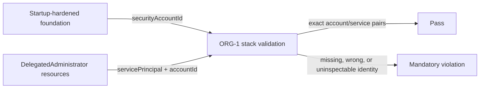

# Runbook: AWS organization delegated-admin account binding

Status: M1 confirmed by the user's standing instruction to continue autonomously with the SLO skills and defensive cybersecurity work only.
Runbook ID: `aws-org-delegated-admin-binding`
Finding: `csf_a0a6457b74727aa196a6129d` — ORG-1 accepts delegated administrators in the wrong account.
Base: `55d328e65d4c441d4f7532605c430c6681ede983`.
Data classification: Internal infrastructure identifiers; AWS account IDs are not secrets.

## 1. Metadata and stable interfaces

| Field                     | Value                                                                                                      |
| ------------------------- | ---------------------------------------------------------------------------------------------------------- |
| Project                   | Hulumi                                                                                                     |
| Primary stack             | TypeScript, Pulumi AWS provider, Pulumi CrossGuard                                                         |
| Package                   | `@hulumi/policies`                                                                                         |
| Prefix                    | `aws-org-delegated-admin-binding`                                                                          |
| Focused test              | `pnpm --filter @hulumi/policies test -- --run tests/aws-org-hardening-pack.test.ts`                        |
| Package test              | `pnpm --filter @hulumi/policies test`                                                                      |
| Build/typecheck/lint      | policy package build, typecheck, and lint; repository format, license-boundary, and exact-pin checks       |
| Dependency/security audit | `python3 scripts/osv-dependency-gate.py --output <report>` plus pinned Semgrep and secret-diff review      |
| New dependencies          | none                                                                                                       |
| Public interface          | `HULUMI-ORG-1-delegated-admins-required` and its exported policy symbol remain named and import-compatible |

ORG-1 becomes stricter without changing component output. For each startup-hardened foundation, every required service must have a delegated-administrator resource whose literal 12-digit `accountId` exactly equals that foundation's literal 12-digit `securityAccountId`.

## 2. Problem and architecture

The current rule builds a global set of `servicePrincipal` values and never reads delegated-administrator `accountId`. A raw resource for the correct service in another member account therefore satisfies the mandatory rule even though the intended security account has no delegated authority.

The policy inspects only the Pulumi preview graph. It does not call AWS or attest live Organizations state.

## 3. Security and outcome contracts

- **Value wedge:** preview cannot confuse a delegate in another account with the foundation's named security account.
- **Threat class:** CWE-284 / incorrect authorization subject binding.
- **Proactive controls:** C1 Implement Access Control; C3 Validate All Input and Handle Exceptions; C7 Enforce Digital Identity.
- **Abuse case:** `tm-hulumi-aws-org-delegated-admin-wrong-account` — a raw GuardDuty delegated administrator uses an attacker-controlled member account while the foundation declares a different security account.
- **Measurement:** deterministic exact-match counts in M1 tests; the target finding must be absent from the exact merged-main Codex Security scan.
- **Detected Work Ledger:** the separate ORG-3 label-only SCP finding remains a distinct milestone because it changes policy content and attachment validation.

### Outcome validation

- `oc-aws-org-delegated-admin-binding-1`: Given a startup-hardened foundation names security account A, when each required service is delegated only to account B, then preview reports one bounded ORG-1 violation for that foundation; when exact delegates to A exist, preview passes.
- `cuj-aws-org-delegated-admin-binding-1`: foundation declaration → stack preview → ORG-1 account/service correlation → operator correction before apply.

## 4. M1 — bind delegated services to the security account

Status: `implementation_complete`; exact-head CI, merge, and merged-main Codex Security validation remain.
Started: 2026-10-15
Local verification completed: 2026-10-15
Refactor budget: No refactor outside the direct ORG-1 validator, tests, and operator documentation.

### Contract block

| Contract item       | M1 decision                                                                                                                                                 |
| ------------------- | ----------------------------------------------------------------------------------------------------------------------------------------------------------- |
| Goal                | Require exact account ownership for all four mandatory delegated services.                                                                                  |
| Exemplar            | The component creates every `DelegatedAdministrator` with `accountId: normalized.securityAccountId`.                                                        |
| Anti-exemplar       | A global set containing only `servicePrincipal`.                                                                                                            |
| Data classification | Internal infrastructure metadata.                                                                                                                           |
| Abuse acceptance    | Wrong-account delegates, missing account IDs, non-string IDs, malformed IDs, and uninspectable foundation identity all fail closed.                         |
| Resource bound      | One linear scan of the finite preview resource list per startup-hardened foundation; four required service principals.                                      |
| Invariant           | For each foundation and service, an exact pair `(servicePrincipal, foundation.securityAccountId)` exists and both account IDs are literal 12-digit strings. |
| Failure behavior    | One bounded mandatory diagnostic per invalid foundation or missing service set; no fallback.                                                                |
| Compatibility       | Correct component-generated resources pass; ORG-2 through ORG-6 remain unchanged.                                                                           |

### Allowed files

- `docs/RUNBOOK-aws-org-delegated-admin-binding.md`
- `docs/slo/critique/aws-org-delegated-admin-binding-m1.md`
- `docs/slo/verify/aws-org-delegated-admin-binding-m1.md`
- `docs/slo/lessons/aws-org-delegated-admin-binding-m1.md`
- `docs/slo/completion/aws-org-delegated-admin-binding-m1.md`
- `packages/policies/src/aws-org/hulumi-aws-org-hardening-pack.ts`
- `packages/policies/tests/aws-org-hardening-pack.test.ts`
- `docs/components/aws-organization-security-foundation.md`
- `docs/cookbooks/aws-organization-guardrails.md`

### BDD acceptance

| ID       | Given/when                                                                           | Then                                                         |
| -------- | ------------------------------------------------------------------------------------ | ------------------------------------------------------------ |
| BDD-M1-1 | no startup-hardened foundation exists                                                | ORG-1 is not applicable and emits no violation               |
| BDD-M1-2 | a foundation omits or has a non-string/malformed `securityAccountId`                 | ORG-1 fails closed and identifies the foundation             |
| BDD-M1-3 | all required service principals exist only under a different or malformed account ID | ORG-1 reports all services missing from the intended account |
| BDD-M1-4 | a wrong-account decoy and a correct delegate both exist for a service                | the exact correct delegate satisfies that service            |
| BDD-M1-5 | two foundations name different security accounts                                     | each foundation is evaluated independently                   |
| BDD-M1-6 | all four exact account/service pairs exist                                           | ORG-1 passes                                                 |
| BDD-M1-7 | ORG-2 through ORG-6 tests run                                                        | unrelated policy behavior remains green                      |

### Evidence log

| Evidence                                      | Required result                                                                       |
| --------------------------------------------- | ------------------------------------------------------------------------------------- |
| Repo hygiene                                  | task branch starts from exact `origin/main`; clean before edits                       |
| Baseline                                      | focused AWS organization suite green before RED changes                               |
| RED                                           | new wrong-account and identity-shape BDDs fail for the missing correlation            |
| Focused/package                               | focused and full policy package suites green                                          |
| Build/typecheck/lint/format/license/exact-pin | all green                                                                             |
| Dependency                                    | no manifest/lock diff; pinned OSV gate reports 0 vulnerable and 0 `MAL-*` occurrences |
| Static/security                               | pinned Semgrep 0 findings/errors; secret diff clean                                   |
| GitHub                                        | signed+DCO exact-head CI green                                                        |
| Post-merge                                    | exact merged-main Codex Security scan completed; target finding absent                |

### Forbidden shortcuts and out of scope

- No service-presence-only fallback and no acceptance of unknown/non-string/malformed account IDs.
- No trust based on URN ancestry, logical names, tags, or foundation outputs alone.
- No AWS API call, deployment, dependency, lockfile, version, release, suppression, CodeQL, or Semgrep-rule change.
- No ORG-3 policy-content or attachment repair in this milestone.

### Definition of done

All BDD and outcome scenarios pass; the exact account-binding rule and operator docs agree; no allow-list drift exists; the signed exact-head PR is green and merged under standing authorization; a merged-main Codex Security scan confirms the target finding absent.

### Local result

- ORG-1 now evaluates each startup-hardened foundation independently and requires an exact service/account pair for all four security services.
- Missing, non-string, and malformed foundation identities fail closed; wrong or malformed delegated-administrator accounts do not count.
- Baseline focused tests passed 7/7; the RED phase produced six intended failures with ten existing/compatibility cases passing; the final focused suite passed 16/16.
- The policy package passed 365/365 and the full workspace build, typecheck, test, and lint completed successfully.
- Formatting, license-boundary, exact-pin, OSV, Semgrep, and high-confidence secret checks passed; no dependency manifest or lockfile changed.
