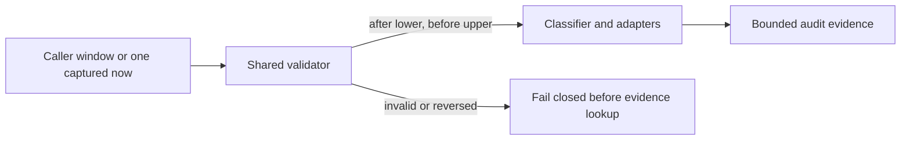

# Runbook: Drift evidence-window contract

Status: M1 confirmed by the user's standing instruction to continue autonomously with the SLO skills and defensive cybersecurity work only.
Runbook ID: `drift-evidence-window-contract`
Findings: `csf_8b25c0b5d92e4e0d42724652` and `csf_892599ddd610aff17faa86e3` — the default classifier and direct CloudTrail adapter invert their chronological evidence bounds.
Base: `bb44c21ca4e9fbe8fccb122c09e0cf301bc84cc8`.
Data classification: Resource identifiers and audit-event timestamps supplied by the caller.

## 1. Metadata and stable interfaces

| Field                     | Value                                                                                                         |
| ------------------------- | ------------------------------------------------------------------------------------------------------------- |
| Project                   | Hulumi                                                                                                        |
| Primary stack             | TypeScript, Vitest, Pulumi                                                                                    |
| Package                   | `@hulumi/drift`                                                                                               |
| Prefix                    | `drift-evidence-window-contract`                                                                              |
| Focused test              | `pnpm --filter @hulumi/drift test -- --run tests/evidence-window-contract.test.ts`                            |
| Package test              | `pnpm --filter @hulumi/drift test`                                                                            |
| Build/typecheck/lint      | drift package build, typecheck, and lint; repository format, license-boundary, and exact-pin checks           |
| Dependency/security audit | `python3 scripts/osv-dependency-gate.py --output <report>` plus pinned Semgrep and secret-diff review         |
| New dependencies          | none                                                                                                          |
| Public interface          | `EvidenceWindow` keeps the existing `before` and `after` property names; their chronological meaning is fixed |

M1 defines one compatibility-preserving contract: `after` is the inclusive lower bound and `before` is the inclusive upper bound. The default window captures one clock reading and spans the preceding 24 hours.

## 2. Problem and architecture

The classifier currently assigns 24 hours ago to `before` and the current time to `after`. All adapters interpret `after` as the start and `before` as the end, so the default interval is empty. The direct CloudTrail default repeats the same inversion. Explicit malformed or reversed bounds are not rejected consistently.

The shared helper validates timestamp order. It does not query a provider, alter cache identity, change verdict scoring, or rename the established public properties.

## 3. Security and outcome contracts

- **Value wedge:** a default audit lookup must cover the intended preceding day instead of silently querying an empty interval.
- **Threat class:** CWE-20 / improper input validation causing missing security evidence.
- **Proactive controls:** C3 Validate All Input and Handle Exceptions; C9 Implement Security Logging and Monitoring.
- **Abuse case:** `tm-hulumi-drift-empty-evidence-window` — an out-of-band mutation escapes classification because the default interval has its chronological bounds reversed.
- **Measurement:** deterministic clock tests prove the 24-hour interval; adapter contract tests prove consistent ordering and fail-closed invalid-window behavior; both findings must be absent from the exact merged-main Codex Security scan.

### Outcome validation

- `oc-drift-evidence-window-1`: Given no caller-supplied window, when classification begins, then every adapter receives the same interval with `after = now - 24h` and `before = now` from one captured clock value.
- `oc-drift-evidence-window-2`: Given invalid or reversed explicit bounds, when classification or a direct adapter lookup is requested, then the request fails closed before provider or git lookup side effects.
- `cuj-drift-evidence-window-1`: drift classification request → ordered bounded evidence collection → verdict with the intended audit interval.

## 4. M1 — ordered, validated evidence windows

Status: `implementation_complete`; exact-head CI, merge, and merged-main Codex Security validation remain.
Started: 2026-10-15
Local verification completed: 2026-10-15
Refactor budget: one small pure helper, compatible type documentation, adapter integration, regression tests, and operator documentation.

### Contract block

| Contract item       | M1 decision                                                                                                                                        |
| ------------------- | -------------------------------------------------------------------------------------------------------------------------------------------------- |
| Goal                | Make every default interval nonempty and every explicit interval structurally valid before lookup.                                                 |
| Exemplar            | The webhook fallback's existing correct comparison `after <= event <= before` and Git's `--since`/`--until` mapping.                               |
| Anti-exemplar       | Separate `Date.now()` calls with the older timestamp stored in `before` and the newer timestamp stored in `after`.                                 |
| Data classification | Resource identifiers and audit timestamps.                                                                                                         |
| Abuse acceptance    | Invalid dates, reversed intervals, and defaults whose lower bound is after their upper bound fail closed.                                          |
| Resource bound      | Constant-time timestamp parsing and comparison; no new network, filesystem, or subprocess work.                                                    |
| Invariant           | `after` is an inclusive lower bound, `before` is an inclusive upper bound, and both parse to finite instants with `after <= before`.               |
| Failure behavior    | Classifier throws before adapter or cache-write side effects; direct adapters return their established degraded signal before provider/git lookup. |
| Compatibility       | Public field names, valid explicit windows, verdict rules, cache schema, TTL, recommendation behavior, and adapter-specific evidence stay stable.  |

### Allowed files

- `docs/RUNBOOK-drift-evidence-window-contract.md`
- `docs/slo/critique/drift-evidence-window-contract-m1.md`
- `docs/slo/verify/drift-evidence-window-contract-m1.md`
- `docs/slo/lessons/drift-evidence-window-contract-m1.md`
- `docs/slo/completion/drift-evidence-window-contract-m1.md`
- `packages/drift/src/evidence-window.ts`
- `packages/drift/src/types.ts`
- `packages/drift/src/classifier.ts`
- `packages/drift/src/adapters/cloudtrail.ts`
- `packages/drift/src/adapters/git-log.ts`
- `packages/drift/src/adapters/github-webhook-fallback.ts`
- `packages/drift/src/index.ts`
- `packages/drift/tests/evidence-window-contract.test.ts`
- `packages/drift/tests/integration/drift-classify.integration.test.ts`
- `packages/drift/tests/namespace-rejection.test.ts`
- `packages/drift/README.md`
- `docs/papers/drift-detection.md`

### BDD acceptance

| ID       | Given/when                                                          | Then                                                                                    |
| -------- | ------------------------------------------------------------------- | --------------------------------------------------------------------------------------- |
| BDD-M1-1 | classifier receives no explicit window at a fixed clock             | every adapter receives one identical ordered 24-hour interval                           |
| BDD-M1-2 | classifier receives an invalid or reversed explicit window          | it rejects before any adapter or probe runs                                             |
| BDD-M1-3 | CloudTrail receives no explicit window at a fixed clock             | lookup receives `after = now - 24h` and `before = now`                                  |
| BDD-M1-4 | CloudTrail, GitLog, or webhook receives invalid or reversed bounds  | the adapter returns a degraded signal without its provider, git, or event lookup path   |
| BDD-M1-5 | GitLog receives a valid interval                                    | `after` maps to `--since` and `before` maps to `--until`                                |
| BDD-M1-6 | webhook receives an event whose timestamp lies inside a valid range | the event remains eligible and existing ordering, replay, and tier behavior stay stable |

### Evidence log

| Evidence                                      | Required result                                                                       |
| --------------------------------------------- | ------------------------------------------------------------------------------------- |
| Repo hygiene                                  | task branch starts from exact `origin/main`; clean before edits                       |
| Baseline                                      | drift package suite green before RED changes                                          |
| RED                                           | new BDDs fail only for missing default-order and validation behavior                  |
| Focused/package                               | focused and full drift package suites green                                           |
| Build/typecheck/lint/format/license/exact-pin | all green                                                                             |
| Dependency                                    | no manifest/lock diff; pinned OSV gate reports 0 vulnerable and 0 `MAL-*` occurrences |
| Static/security                               | pinned Semgrep 0 findings/errors; secret diff clean                                   |
| GitHub                                        | signed+DCO exact-head CI green                                                        |
| Post-merge                                    | exact merged-main Codex Security scan completed; both target findings absent          |

### Forbidden shortcuts and out of scope

- No field rename, adapter-specific polarity, permissive date coercion, swapped-bound auto-correction, or silent invalid-window fallback.
- No dependency, lockfile, manifest, version, publication, live cloud, cache-schema, verdict-matrix, suppression, CodeQL, Semgrep-rule, or secret-scanner change.
- No implementation of unrelated drift-cache, webhook-storage, or reconciler findings.

### Definition of done

All BDD and outcome scenarios pass; source and operator docs state one evidence-window contract; no allow-list drift exists; the signed exact-head PR is green and merged under standing authorization; an exact merged-main Codex Security scan confirms both findings absent.

### Local result

- `EvidenceWindow` now defines `after` as the inclusive lower bound and `before` as the inclusive upper bound; one helper constructs the default from a single clock reading and validates explicit input.
- Classifier validation occurs before cache lookup. Direct CloudTrail, GitLog, and webhook calls return degraded signals before evidence-source work on invalid or reversed input.
- Baseline passed 138/138. RED reproduced seven intended failures with the Git polarity control passing. Focused GREEN passed 8/8 and the drift package passed 146/146.
- Full workspace build, typecheck, test, and lint passed. Formatting, license-boundary, exact-pin, OSV, Semgrep, secret, and diff gates passed; no dependency manifest or lockfile changed.
