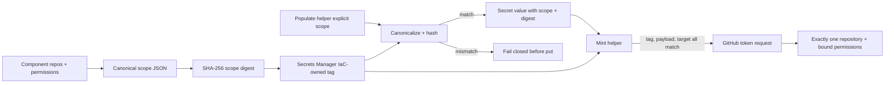

# Runbook: GitHub App token scope integrity

Status: M1 confirmed by the user's standing instruction to continue autonomously with the SLO skills on defensive cybersecurity work.
Runbook ID: `github-app-token-scope-integrity`
Finding: `csf_04763dccfdc9b9ef9cdd2c4c` — component repository and permission policy is not bound to the population or token-minting helpers.
Base: `8a34a60eae79c0a86a3e80b54193dee2c24e32aa`.
Data classification: repository names and permission names are internal configuration; App IDs are identifiers; private keys and installation tokens are secret.

## 1. Metadata and stable interfaces

| Field                     | Value                                                                                                                                                                                       |
| ------------------------- | ------------------------------------------------------------------------------------------------------------------------------------------------------------------------------------------- |
| Project                   | Hulumi                                                                                                                                                                                      |
| Primary stack             | TypeScript, Pulumi, Bash, AWS Secrets Manager, GitHub App REST API                                                                                                                          |
| Package                   | `@hulumi/k8s-baseline`                                                                                                                                                                      |
| Prefix                    | `github-app-token-scope-integrity`                                                                                                                                                          |
| Focused test              | `pnpm --filter @hulumi/k8s-baseline test -- --run tests/github-app-credential.test.ts`                                                                                                      |
| Package gates             | test, build, typecheck, lint                                                                                                                                                                |
| Dependency/security audit | `python3 scripts/osv-dependency-gate.py --output <report>` plus Semgrep, shell review, and secret-diff review                                                                               |
| New dependencies          | none                                                                                                                                                                                        |
| Public compatibility      | Existing constructor inputs and script paths remain; `scopeDigest` is additive. The population helper intentionally removes unsafe three-argument defaults and now requires explicit scope. |

GitHub's official API states that omitting `repositories` gives a token every repository available to the installation and omitting `permissions` gives every App permission. The request accepts up to 500 repository names. M1 therefore makes both fields mandatory in the runtime request even when the component allowlist is `['*']`; wildcard means any installation repository may be selected, not that the minted token may cover them all.

## 2. Problem and architecture

The component validates `repos` and `permissions`, but the population helper independently defaults them to `['*']` and `{}`. The mint helper also defaults absent secret fields and omits `repositories` in wildcard mode. A caller can therefore provision a narrow-looking component and mint a token with installation-wide repositories or App-wide permissions.

The Secrets Manager tag `hulumi:github-app-scope-sha256` is the IaC-owned binding. Both scripts canonicalize the same bounded scope shape and recompute its digest. The read policy already grants `DescribeSecret`, while it does not grant tag mutation, so the runtime principal can verify but cannot change this binding.

## 3. Security and outcome contracts

- **Value wedge:** the policy reviewed in Pulumi is the policy enforced at token mint time.
- **Threat class:** CWE-284 improper access control and CWE-345 insufficient verification of data authenticity.
- **Abuse case:** `tm-hulumi-github-app-scope-substitution` — an operator or compromised secret value supplies broader repositories or permissions than the component declared, or wildcard mode omits repository restriction.
- **Measurement:** scope substitution rejects before `put-secret-value` or GitHub token exchange; every successful token request includes one target repository name and the non-empty bound permission map.
- **Provider evidence:** GitHub documents that omitted repository and permission fields inherit the installation/App grant, `repositories` contains repository names, and a token lasts one hour. AWS documents tag values up to 256 characters, sufficient for a 64-character SHA-256 digest.

### Outcome validation

- `oc-github-app-scope-1`: Given a component-declared scope, when a population caller changes, omits, or malforms repositories or permissions, then no secret value is written.
- `oc-github-app-scope-2`: Given a secret whose scope, digest, or IaC tag does not agree, when minting is requested, then no JWT signing or GitHub token request occurs.
- `oc-github-app-scope-3`: Given either an explicit allowlist or wildcard allowlist and an allowed target, when token minting succeeds, then the GitHub request contains `repositories: [REPO_NAME]` and exactly the bound permission map.
- `cuj-github-app-scope-1`: component declaration → tagged secret container → explicit population → digest verification → target authorization → single-repository installation token.

## 4. M1 — bind component scope to every token request

Status: local execution and verification complete; exact-head CI, merge, and merged-main scan pending.
Started: 2026-10-15
Refactor budget: the component's scope contract, its two packaged helpers, focused tests, component documentation, and SLO evidence.

### Contract block

| Contract item       | M1 decision                                                                                                                                                                                  |
| ------------------- | -------------------------------------------------------------------------------------------------------------------------------------------------------------------------------------------- |
| Goal                | Prevent helpers from broadening component-declared repository or permission authority.                                                                                                       |
| Exemplar            | Existing single-secret IAM policy: one component resource establishes one narrow runtime authority boundary.                                                                                 |
| Anti-exemplar       | Optional runtime scope with `['*']` and `{}` defaults, plus wildcard requests that omit `repositories`.                                                                                      |
| Data classification | Scope metadata is internal; private keys, JWTs, secret payloads, and installation tokens are secret.                                                                                         |
| Abuse acceptance    | Missing/empty/malformed/duplicate/mixed-wildcard/oversized repos, missing/empty/invalid permissions, tag mismatch, secret digest mismatch, and disallowed target all fail closed.            |
| Resource bound      | At most 500 repository entries, 100 permission entries, 16 KiB canonical scope, and 64 KiB complete secret payload.                                                                          |
| Invariant           | A successful token request always names exactly one repository and carries the exact non-empty permission map whose canonical SHA-256 equals both the secret payload digest and the IaC tag. |
| Failure behavior    | Emit a reason-only `security_event`, never print key/JWT/token/scope bytes, and perform no later side effect.                                                                                |
| Compatibility       | Constructor inputs remain; `scopeDigest` is additive. Three-argument population calls fail with migration guidance because their old defaults widened authority.                             |

### Allowed files

- `docs/RUNBOOK-github-app-token-scope-integrity.md`
- `docs/slo/critique/github-app-token-scope-integrity-m1.md`
- `docs/slo/verify/github-app-token-scope-integrity-m1.md`
- `docs/slo/lessons/github-app-token-scope-integrity-m1.md`
- `docs/slo/completion/github-app-token-scope-integrity-m1.md`
- `packages/k8s-baseline/src/github-app-credential.ts`
- `packages/k8s-baseline/src/github-app-credential.args.ts`
- `packages/k8s-baseline/src/github-app-credential.outputs.ts`
- `packages/k8s-baseline/scripts/populate-github-app-secret.sh`
- `packages/k8s-baseline/scripts/mint-github-app-token.sh`
- `packages/k8s-baseline/tests/github-app-credential.test.ts`
- `docs/components/github-app-credential.md`

### BDD acceptance

| ID       | Given/when                                                                                            | Then                                                                              |
| -------- | ----------------------------------------------------------------------------------------------------- | --------------------------------------------------------------------------------- |
| BDD-M1-1 | component inputs contain duplicate, malformed, mixed-wildcard, oversized repos or invalid permissions | construction rejects before child resources                                       |
| BDD-M1-2 | semantically identical scope has different input key/order                                            | component tag and output expose the same deterministic 64-hex digest              |
| BDD-M1-3 | population scope is omitted or differs from the secret tag                                            | helper rejects before `put-secret-value`                                          |
| BDD-M1-4 | populated secret scope/digest differs from the current secret tag                                     | mint helper rejects before signing or HTTP                                        |
| BDD-M1-5 | target is outside an explicit allowlist                                                               | mint helper rejects before signing or HTTP                                        |
| BDD-M1-6 | explicit allowlist permits target                                                                     | request has `repositories: [REPO_NAME]` and exact permissions                     |
| BDD-M1-7 | wildcard allowlist permits target                                                                     | request still has `repositories: [REPO_NAME]` and exact permissions               |
| BDD-M1-8 | any helper fails                                                                                      | stdout contains no key/JWT/token and stderr contains only bounded reason metadata |
| BDD-M1-9 | package and workspace regressions run                                                                 | existing component behavior remains green with no dependency graph change         |

### Evidence log

| Evidence        | Required result                                                                        |
| --------------- | -------------------------------------------------------------------------------------- |
| Repo hygiene    | branch starts from exact merged `origin/main`                                          |
| Baseline        | focused component tests and package gates pass before RED changes                      |
| RED             | new binding BDDs fail only for missing scope integrity controls                        |
| Focused/package | complete component and package test/build/typecheck/lint pass                          |
| Dependency      | no manifest/lock diff; official OSV gate reports zero vulnerabilities and zero `MAL-*` |
| Static/security | Semgrep and shell review report zero findings/errors; secret diff clean                |
| GitHub          | signed+DCO exact-head CI green                                                         |
| Post-merge      | exact merged-main Codex Security scan completed; source finding absent                 |

### Local result

- Baseline: 17/17 focused tests plus package build, typecheck, and lint.
- RED: 15 intended failures and 15 passing controls against the old helper behavior.
- GREEN: 34/34 focused tests and 265/265 complete package tests.
- Full workspace test, build, typecheck, lint, format, license, exact-pin, and workflow-governance gates passed across 19 runnable projects.
- Bash syntax and ShellCheck passed for both helpers.
- Official OSV-Scanner 2.7.0 scanned two unchanged lockfiles and 575 package occurrences with zero vulnerabilities and zero `MAL-*`.
- Semgrep 1.156.0 ran 74 rules over four changed TypeScript files with zero findings and zero errors.
- Secret review, exact allow-list, dependency diff, and diff hygiene passed.

### Forbidden shortcuts and out of scope

- No empty-permission default, omission of `repositories`, mutable tag fallback, digest bypass, scope-byte logging, token/key/JWT logging, plaintext IaC secret value, live credential, or live AWS/GitHub mutation.
- No new package, lockfile, version, publication, App-registration, installation-management, IAM-expansion, or unrelated component change.
- No claim that a SHA-256 digest makes untrusted tags authoritative; the boundary relies on IaC ownership and the runtime role's lack of tag mutation permission.

### Definition of done

All BDD and outcome scenarios pass; provider request shape matches official GitHub documentation; no allow-list drift or dependency change exists; the signed exact-head PR is green and merged under standing authorization; an exact merged-main Codex Security scan confirms the source finding is absent.
