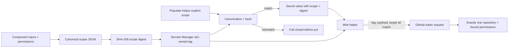
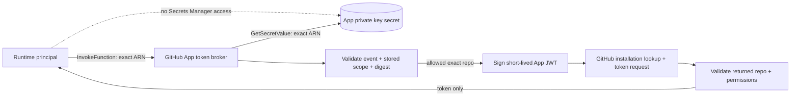

# Runbook: GitHub App token scope integrity

Status: M1 merged; M2 local execution and verification passed, with exact-head CI and merged-main Codex Security pending.
Runbook ID: `github-app-token-scope-integrity`
Findings: `csf_04763dccfdc9b9ef9cdd2c4c` (M1) and `csf_7b681c175edc7c44f60bd797` (M2) — a runtime secret reader can export the App private key and bypass the component-bound scope.
M2 base: `fd319eed1bc676068c84164894de27b4aa33d718`.
Data classification: repository names and permission names are internal configuration; App IDs are identifiers; private keys and installation tokens are secret.

## 1. Metadata and stable interfaces

| Field                     | Value                                                                                                                                                                                       |
| ------------------------- | ------------------------------------------------------------------------------------------------------------------------------------------------------------------------------------------- |
| Project                   | Hulumi                                                                                                                                                                                      |
| Primary stack             | TypeScript, Pulumi, Bash, AWS Secrets Manager, GitHub App REST API                                                                                                                          |
| Package                   | `@hulumi/k8s-baseline`                                                                                                                                                                      |
| Prefix                    | `github-app-token-scope-integrity`                                                                                                                                                          |
| Focused test              | `pnpm --filter @hulumi/k8s-baseline test -- --run tests/github-app-credential.test.ts`                                                                                                      |
| Package gates             | test, build, typecheck, lint                                                                                                                                                                |
| Dependency/security audit | `python3 scripts/osv-dependency-gate.py --output <report>` plus Semgrep, shell review, and secret-diff review                                                                               |
| New dependencies          | none                                                                                                                                                                                        |
| Public compatibility      | Existing constructor inputs and script paths remain; `scopeDigest` is additive. The population helper intentionally removes unsafe three-argument defaults and now requires explicit scope. |

GitHub's official API states that omitting `repositories` gives a token every repository available to the installation and omitting `permissions` gives every App permission. The request accepts up to 500 repository names. M1 therefore makes both fields mandatory in the runtime request even when the component allowlist is `['*']`; wildcard means any installation repository may be selected, not that the minted token may cover them all.

## 2. Problem and architecture

The component validates `repos` and `permissions`, but the population helper independently defaults them to `['*']` and `{}`. The mint helper also defaults absent secret fields and omits `repositories` in wildcard mode. A caller can therefore provision a narrow-looking component and mint a token with installation-wide repositories or App-wide permissions.

The Secrets Manager tag `hulumi:github-app-scope-sha256` is the IaC-owned binding. Both scripts canonicalize the same bounded scope shape and recompute its digest. The read policy already grants `DescribeSecret`, while it does not grant tag mutation, so the runtime principal can verify but cannot change this binding.

## 3. Security and outcome contracts

- **Value wedge:** the policy reviewed in Pulumi is the policy enforced at token mint time.
- **Threat class:** CWE-284 improper access control and CWE-345 insufficient verification of data authenticity.
- **Abuse case:** `tm-hulumi-github-app-scope-substitution` — an operator or compromised secret value supplies broader repositories or permissions than the component declared, or wildcard mode omits repository restriction.
- **Measurement:** scope substitution rejects before `put-secret-value` or GitHub token exchange; every successful token request includes one target repository name and the non-empty bound permission map.
- **Provider evidence:** GitHub documents that omitted repository and permission fields inherit the installation/App grant, `repositories` contains repository names, and a token lasts one hour. AWS documents tag values up to 256 characters, sufficient for a 64-character SHA-256 digest.

### Outcome validation

- `oc-github-app-scope-1`: Given a component-declared scope, when a population caller changes, omits, or malforms repositories or permissions, then no secret value is written.
- `oc-github-app-scope-2`: Given a secret whose scope, digest, or IaC tag does not agree, when minting is requested, then no JWT signing or GitHub token request occurs.
- `oc-github-app-scope-3`: Given either an explicit allowlist or wildcard allowlist and an allowed target, when token minting succeeds, then the GitHub request contains `repositories: [REPO_NAME]` and exactly the bound permission map.
- `cuj-github-app-scope-1`: component declaration → tagged secret container → explicit population → digest verification → target authorization → single-repository installation token.

## 4. M1 — bind component scope to every token request

Status: merged as `f9b888596ba933f69f183a542e7ab4926287a546`; a merged-main scan found the deeper M2 key-export bypass.
Started: 2026-10-15
Refactor budget: the component's scope contract, its two packaged helpers, focused tests, component documentation, and SLO evidence.

### Contract block

| Contract item       | M1 decision                                                                                                                                                                                  |
| ------------------- | -------------------------------------------------------------------------------------------------------------------------------------------------------------------------------------------- |
| Goal                | Prevent helpers from broadening component-declared repository or permission authority.                                                                                                       |
| Exemplar            | Existing single-secret IAM policy: one component resource establishes one narrow runtime authority boundary.                                                                                 |
| Anti-exemplar       | Optional runtime scope with `['*']` and `{}` defaults, plus wildcard requests that omit `repositories`.                                                                                      |
| Data classification | Scope metadata is internal; private keys, JWTs, secret payloads, and installation tokens are secret.                                                                                         |
| Abuse acceptance    | Missing/empty/malformed/duplicate/mixed-wildcard/oversized repos, missing/empty/invalid permissions, tag mismatch, secret digest mismatch, and disallowed target all fail closed.            |
| Resource bound      | At most 500 repository entries, 100 permission entries, 16 KiB canonical scope, and 64 KiB complete secret payload.                                                                          |
| Invariant           | A successful token request always names exactly one repository and carries the exact non-empty permission map whose canonical SHA-256 equals both the secret payload digest and the IaC tag. |
| Failure behavior    | Emit a reason-only `security_event`, never print key/JWT/token/scope bytes, and perform no later side effect.                                                                                |
| Compatibility       | Constructor inputs remain; `scopeDigest` is additive. Three-argument population calls fail with migration guidance because their old defaults widened authority.                             |

### Allowed files

- `docs/RUNBOOK-github-app-token-scope-integrity.md`
- `docs/slo/critique/github-app-token-scope-integrity-m1.md`
- `docs/slo/verify/github-app-token-scope-integrity-m1.md`
- `docs/slo/lessons/github-app-token-scope-integrity-m1.md`
- `docs/slo/completion/github-app-token-scope-integrity-m1.md`
- `packages/k8s-baseline/src/github-app-credential.ts`
- `packages/k8s-baseline/src/github-app-credential.args.ts`
- `packages/k8s-baseline/src/github-app-credential.outputs.ts`
- `packages/k8s-baseline/scripts/populate-github-app-secret.sh`
- `packages/k8s-baseline/scripts/mint-github-app-token.sh`
- `packages/k8s-baseline/tests/github-app-credential.test.ts`
- `docs/components/github-app-credential.md`

### BDD acceptance

| ID       | Given/when                                                                                            | Then                                                                              |
| -------- | ----------------------------------------------------------------------------------------------------- | --------------------------------------------------------------------------------- |
| BDD-M1-1 | component inputs contain duplicate, malformed, mixed-wildcard, oversized repos or invalid permissions | construction rejects before child resources                                       |
| BDD-M1-2 | semantically identical scope has different input key/order                                            | component tag and output expose the same deterministic 64-hex digest              |
| BDD-M1-3 | population scope is omitted or differs from the secret tag                                            | helper rejects before `put-secret-value`                                          |
| BDD-M1-4 | populated secret scope/digest differs from the current secret tag                                     | mint helper rejects before signing or HTTP                                        |
| BDD-M1-5 | target is outside an explicit allowlist                                                               | mint helper rejects before signing or HTTP                                        |
| BDD-M1-6 | explicit allowlist permits target                                                                     | request has `repositories: [REPO_NAME]` and exact permissions                     |
| BDD-M1-7 | wildcard allowlist permits target                                                                     | request still has `repositories: [REPO_NAME]` and exact permissions               |
| BDD-M1-8 | any helper fails                                                                                      | stdout contains no key/JWT/token and stderr contains only bounded reason metadata |
| BDD-M1-9 | package and workspace regressions run                                                                 | existing component behavior remains green with no dependency graph change         |

### Evidence log

| Evidence        | Required result                                                                        |
| --------------- | -------------------------------------------------------------------------------------- |
| Repo hygiene    | branch starts from exact merged `origin/main`                                          |
| Baseline        | focused component tests and package gates pass before RED changes                      |
| RED             | new binding BDDs fail only for missing scope integrity controls                        |
| Focused/package | complete component and package test/build/typecheck/lint pass                          |
| Dependency      | no manifest/lock diff; official OSV gate reports zero vulnerabilities and zero `MAL-*` |
| Static/security | Semgrep and shell review report zero findings/errors; secret diff clean                |
| GitHub          | signed+DCO exact-head CI green                                                         |
| Post-merge      | exact merged-main Codex Security scan completed; source finding absent                 |

### Local result

- Baseline: 17/17 focused tests plus package build, typecheck, and lint.
- RED: 15 intended failures and 15 passing controls against the old helper behavior.
- GREEN: 34/34 focused tests and 265/265 complete package tests.
- Full workspace test, build, typecheck, lint, format, license, exact-pin, and workflow-governance gates passed across 19 runnable projects.
- Bash syntax and ShellCheck passed for both helpers.
- Official OSV-Scanner 2.7.0 scanned two unchanged lockfiles and 575 package occurrences with zero vulnerabilities and zero `MAL-*`.
- Semgrep 1.156.0 ran 74 rules over four changed TypeScript files with zero findings and zero errors.
- Secret review, exact allow-list, dependency diff, and diff hygiene passed.

### Forbidden shortcuts and out of scope

- No empty-permission default, omission of `repositories`, mutable tag fallback, digest bypass, scope-byte logging, token/key/JWT logging, plaintext IaC secret value, live credential, or live AWS/GitHub mutation.
- No new package, lockfile, version, publication, App-registration, installation-management, IAM-expansion, or unrelated component change.
- No claim that a SHA-256 digest makes untrusted tags authoritative; the boundary relies on IaC ownership and the runtime role's lack of tag mutation permission.

### Definition of done

All BDD and outcome scenarios pass; provider request shape matches official GitHub documentation; no allow-list drift or dependency change exists; the signed exact-head PR is green and merged under standing authorization; an exact merged-main Codex Security scan confirms the source finding is absent.

## 5. M2 — isolate the App private key behind a scope-enforcing broker

Status: local execution and verification passed; shipping gates pending.
Started: 2026-10-15
Base: `fd319eed1bc676068c84164894de27b4aa33d718`
Refactor budget: the existing component, its two packaged helpers, focused tests, component documentation, and the existing SLO evidence files.

### Why M1 was insufficient

M1 verifies scope in the packaged mint helper, but its runtime IAM policy still grants the caller `secretsmanager:GetSecretValue`. A compromised caller can skip the helper, export the private key, sign its own App JWT, and request any authority available to the App installation. The scope tag therefore constrains the helper without constraining the principal.

M2 reuses the local SunLit Guardian broker pattern: the caller proves only its right to invoke a narrow service, while the service owns the credential and returns a different short-lived bearer. SunLitSecurityLibraries' strict capability design supplies the supporting principles: bind authority to an exact operation and tenant/resource, keep lifetime bounded, validate every claim before secret use, and fail closed. Neither local library provides a GitHub-specific broker, so the GitHub exchange remains in this component without adding a dependency.

### Contract block

| Contract item       | M2 decision                                                                                                                                                                                                                                                                                                                                                                         |
| ------------------- | ----------------------------------------------------------------------------------------------------------------------------------------------------------------------------------------------------------------------------------------------------------------------------------------------------------------------------------------------------------------------------------- |
| Goal                | Make the component's declared repository and permission scope unavoidable even if the runtime caller is compromised.                                                                                                                                                                                                                                                                |
| Exemplar            | Guardian's upstream broker owns the signing credential and forwards a different, narrow, short-lived bearer rather than exporting its key.                                                                                                                                                                                                                                          |
| Anti-exemplar       | A runtime role that can call `GetSecretValue`, sign arbitrary App JWTs, or mint tokens without broker validation.                                                                                                                                                                                                                                                                   |
| Data classification | Repository and permission scope is internal; App private key, App JWT, and installation token are secret.                                                                                                                                                                                                                                                                           |
| Invariant           | Only the broker execution role reads the exact secret and decrypts its exact KMS key through Secrets Manager for that secret; a runtime role can invoke only the exact broker; every returned token is for exactly one allowed `owner/name` repository and exactly the bound permission map.                                                                                        |
| Failure behavior    | Reject before signing or GitHub HTTP when event, secret payload, digest, allowlist, or permissions disagree; return/emit bounded reason codes without key, JWT, token, secret, or request authorization headers.                                                                                                                                                                    |
| Resource bounds     | 16 KiB canonical scope, 64 KiB secret payload, 16 KiB GitHub response bodies, 10-second HTTP timeout, one repository per token, 500 configured repositories, and 100 permissions.                                                                                                                                                                                                   |
| Compatibility       | Existing constructor inputs and script paths remain; optional `kmsKeyArn` avoids a provider lookup when the exact ARN is known. `iamReadPolicyArn` remains as a deprecated alias for the invoke-only policy; `iamInvokePolicyArn`, `brokerFunctionArn`, and `brokerFunctionName` are additive. The mint helper's first argument changes from secret ID to broker function name/ARN. |

The broker uses Node's built-in `crypto` and existing exact-pinned `@aws-sdk/client-secrets-manager`; no dependency graph changes. It supplies an explicit least-privilege execution role because Pulumi's CallbackFunction documentation permits auto-created policies when no role is supplied. The role trusts only `lambda.amazonaws.com` and receives inline access to the exact secret, `kms:Decrypt` on the exact customer-managed key constrained by `kms:ViaService` and the secret encryption context, plus its own exact CloudWatch log group. The runtime policy has only `lambda:InvokeFunction` on the exact function.

GitHub documents that token creation defaults to all installed repositories and all App permissions when narrowing fields are omitted. The broker always sends one repository name and the bound permission map. GitHub's response includes `permissions` and `repositories`, so the broker validates both before returning the token.

### Allowed files

M2 retains M1's exact 12-file allow-list. No package manifest, lockfile, workflow, release, or unrelated component file may change.

### BDD acceptance

| ID       | Given/when                                                         | Then                                                                                                                                                                                     |
| -------- | ------------------------------------------------------------------ | ---------------------------------------------------------------------------------------------------------------------------------------------------------------------------------------- |
| BDD-M2-1 | component creates runtime authority                                | its policy has only `lambda:InvokeFunction` on the exact broker ARN and contains no Secrets Manager action                                                                               |
| BDD-M2-2 | broker execution authority is rendered                             | its role trusts only Lambda; its inline policy reads only the exact secret, decrypts only the exact KMS key through Secrets Manager for that secret, and writes only its exact log group |
| BDD-M2-3 | caller requests a malformed or unallowed repository                | broker rejects before secret retrieval, signing, or GitHub HTTP                                                                                                                          |
| BDD-M2-4 | secret payload or digest differs from component-bound scope        | broker rejects before signing or GitHub HTTP                                                                                                                                             |
| BDD-M2-5 | GitHub returns a different repository or permission map            | broker refuses the token                                                                                                                                                                 |
| BDD-M2-6 | GitHub returns exactly one target repository and exact permissions | broker returns only the non-empty token and expiry metadata                                                                                                                              |
| BDD-M2-7 | packaged mint helper runs                                          | it invokes Lambda, prints only the token, and contains no secret read, OpenSSL signing, or GitHub HTTP path                                                                              |
| BDD-M2-8 | any broker/helper path fails                                       | logs and errors contain a bounded reason and no private key, App JWT, installation token, or authorization header                                                                        |
| BDD-M2-9 | package/workspace/security gates run                               | all regressions pass with no manifest or lockfile diff and OSV/Semgrep/secret review clean                                                                                               |

### Execution sequence and proof

1. Baseline: official pinned OSV Scanner 2.7.0 scans the two resolved lockfiles and full 575-occurrence graph; restore the exact admitted graph offline with scripts disabled; run the existing 34 focused tests.
2. RED: add M2 BDDs for IAM isolation, broker validation and response binding, and the Lambda-only helper; preserve their expected failures before implementation.
3. GREEN: create the explicit broker role/log group/function, exact secret policy, exact invoke policy, pure broker handler seam, and updated helper/documentation.
4. Verify focused and package tests, build, typecheck, lint, format, workspace regressions, Bash/ShellCheck, Semgrep, secret review, allow-list, diff hygiene, and a final official OSV scan.
5. Sign and DCO-stamp the exact source commit, pass exact-head CI, merge only the reviewed head under standing authorization, and run xhigh Codex Security on the exact merged-main commit.

### Local result

- Baseline: the official pinned OSV-Scanner 2.7.0 scanned two resolved lockfiles and 575 package occurrences with zero vulnerabilities and zero `MAL-*`; a frozen, offline, script-disabled install reused 422 admitted packages and downloaded none; the existing focused suite passed 34/34.
- RED: 12 intended M2 failures with 24 controls passing covered raw-secret runtime authority, missing broker isolation, unchecked provider scope, and the direct-read mint path.
- GREEN: the focused suite passed 40/40 and the complete `@hulumi/k8s-baseline` suite passed 271/271.
- Full workspace test, build, typecheck, and lint passed across all 19 runnable projects; formatting, license-boundary, exact-pin, and workflow-governance gates also passed.
- Bash syntax and ShellCheck passed for both packaged helpers. Semgrep 1.156.0 ran 74 TypeScript rules over four changed TypeScript files with zero findings and zero errors.
- The final OSV report remained two lockfiles, 575 package occurrences, zero vulnerabilities, and zero `MAL-*`. No manifest, lockfile, dependency, version, publication, or live-cloud change exists.
- Manual diff review confirmed the runtime policy contains only exact broker invocation; the broker role has exact secret read, exact KMS decrypt constraints, and exact log-stream authority; the helper has no Secrets Manager, OpenSSL, or GitHub request path; added lines contain no high-confidence credential material.

### Forbidden shortcuts and out of scope

- No raw private-key output, runtime `secretsmanager:GetSecretValue`, wildcard IAM resource/action, Pulumi-generated broad Lambda policy, omitted GitHub repositories/permissions, unchecked token response, secret/JWT/token logging, live credential, or live AWS/GitHub mutation.
- No new dependency, manifest, lockfile, version, publication, App registration, installation lifecycle, rotation service, API Gateway, public endpoint, queue, database, or unrelated component change.
- The broker is invoked through AWS IAM; designing a second application-level caller token would duplicate the platform authorization boundary and is outside this bounded finding repair.

### Definition of done

Every M2 BDD passes; the runtime role cannot retrieve or export the private key; the broker alone can read the exact secret and verifies both requested and returned authority; the exact-head PR is green and merged; an exact merged-main Codex Security scan no longer reports `csf_7b681c175edc7c44f60bd797` or an equivalent raw-key bypass.
