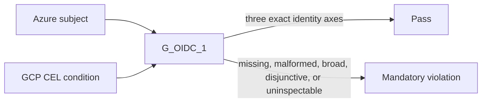

# Runbook: Azure and GCP GitHub OIDC subject binding

Status: M1 confirmed by the user's standing instruction to continue autonomously with the SLO skills and defensive cybersecurity work only.
Runbook ID: `github-cloud-oidc-subject-binding`
Findings: `csf_c43a103ee0825be80e6d5c2a` and `csf_d7fa022948f19b61b4e59860` — Azure and GCP GitHub OIDC policy paths accept missing or broadly scoped subjects.
Base: `0331c5b6ea9660925751cbfa4fa580a6af775b2f`.
Data classification: Public repository, workflow, and environment identifiers.

## 1. Metadata and stable interfaces

| Field                     | Value                                                                                                        |
| ------------------------- | ------------------------------------------------------------------------------------------------------------ |
| Project                   | Hulumi                                                                                                       |
| Primary stack             | TypeScript, Pulumi CrossGuard                                                                                |
| Package                   | `@hulumi/policies`                                                                                           |
| Prefix                    | `github-cloud-oidc-subject-binding`                                                                          |
| Focused test              | `pnpm --filter @hulumi/policies test -- --run tests/github/hulumi-hardening-pack.test.ts`                    |
| Package test              | `pnpm --filter @hulumi/policies test`                                                                        |
| Build/typecheck/lint      | policy package build, typecheck, and lint; repository format, license-boundary, and exact-pin checks         |
| Dependency/security audit | `python3 scripts/osv-dependency-gate.py --output <report>` plus pinned Semgrep and secret-diff review        |
| New dependencies          | none                                                                                                         |
| Public interface          | `G_OIDC_1`, H3 alias, exported resource-type constants, suppression key, and AWS rule behavior remain stable |

M1 makes the Azure and GCP branches match the rule's existing three-axis security contract. An Azure subject must encode `repo`, `job_workflow_ref`, and `environment` exactly once. A GCP condition must be a bounded conjunction of exact string equalities that binds `assertion.repository`, `assertion.job_workflow_ref`, and `assertion.environment` exactly once.

## 2. Problem and architecture

The Azure validator returns clean when `subject` is absent or non-string and rejects only `*`. The GCP validator behaves the same for `attributeCondition`, so `true`, an organization-only expression, or a repository-free expression can pass a mandatory rule.

The policy inspects literal Pulumi preview inputs. It does not call Azure, Google Cloud, or GitHub and does not attest live identity-provider state.

## 3. Security and outcome contracts

- **Value wedge:** a mandatory preview gate cannot report clean when GitHub cloud federation omits repository, reusable-workflow, or environment identity.
- **Threat class:** CWE-284 / incorrect authorization subject binding.
- **Proactive controls:** C1 Implement Access Control; C3 Validate All Input and Handle Exceptions; C7 Enforce Digital Identity.
- **Abuse case:** `tm-hulumi-github-cloud-oidc-broad-subject` — an operator or compromised IaC change uses a constant-true or partial trust expression so unrelated workflows can exchange tokens.
- **Measurement:** deterministic Azure subject and GCP expression matrices; both findings must be absent from the exact merged-main Codex Security scan.
- **Provider evidence:** Microsoft requires exact case-sensitive issuer, subject, and audience matching; Google warns that shared deployment-pipeline issuers require an attribute condition; GitHub exposes repository, reusable-workflow, and environment claims for trust binding.

### Outcome validation

- `oc-github-cloud-oidc-subject-binding-1`: Given a preview-visible Azure or GCP GitHub federation resource, when any required identity axis is missing, uninspectable, duplicated, wildcarded, or placed behind a disjunction, then `G_OIDC_1` reports one bounded mandatory violation; when all axes are exact conjunctive literals, preview passes.
- `cuj-github-cloud-oidc-subject-binding-1`: federation declaration → stack preview → subject/condition proof → operator correction before apply.

## 4. M1 — fail closed on Azure and GCP subject scope

Status: `implementation_complete`; exact-head CI, merge, and merged-main Codex Security validation remain.
Started: 2026-10-15
Local verification completed: 2026-10-15
Refactor budget: No refactor outside the two provider inspectors and their small pure parsers, tests, and operator documentation.

### Contract block

| Contract item       | M1 decision                                                                                                                                                                        |
| ------------------- | ---------------------------------------------------------------------------------------------------------------------------------------------------------------------------------- |
| Goal                | Prove exact repository, reusable-workflow, and environment binding in Azure subjects and GCP conditions.                                                                           |
| Exemplar            | Existing H2 claim-key validation and the fail-closed AWS trust-policy parser.                                                                                                      |
| Anti-exemplar       | `typeof value !== "string"` returning clean and substring-only wildcard checks.                                                                                                    |
| Data classification | Public identity metadata.                                                                                                                                                          |
| Abuse acceptance    | Missing/non-string/empty values, malformed pairs/tokens, duplicate axes, wildcards, tautologies, disjunctions, functions, and incomplete bindings fail closed.                     |
| Resource bound      | Azure: one bounded token scan. GCP: one tokenizer/parser pass over a finite preview string; no evaluation, backtracking, or provider call.                                         |
| Invariant           | Azure has each required subject key exactly once; GCP's whole accepted grammar is conjunction/parentheses/exact string equality and includes each required assertion exactly once. |
| Failure behavior    | One bounded mandatory diagnostic per invalid resource; no coercion, inferred default, or fallback.                                                                                 |
| Compatibility       | Safe extra Azure claim pairs and safe extra GCP exact equalities pass; AWS validation, rule names, aliases, and suppression semantics remain unchanged.                            |

### Allowed files

- `docs/RUNBOOK-github-cloud-oidc-subject-binding.md`
- `docs/slo/critique/github-cloud-oidc-subject-binding-m1.md`
- `docs/slo/verify/github-cloud-oidc-subject-binding-m1.md`
- `docs/slo/lessons/github-cloud-oidc-subject-binding-m1.md`
- `docs/slo/completion/github-cloud-oidc-subject-binding-m1.md`
- `packages/policies/src/github/g-oidc-1.ts`
- `packages/policies/tests/github/hulumi-hardening-pack.test.ts`
- `docs/components/g-oidc-1.md`

### BDD acceptance

| ID       | Given/when                                                                  | Then                                              |
| -------- | --------------------------------------------------------------------------- | ------------------------------------------------- |
| BDD-M1-1 | Azure subject is absent, non-string, empty, malformed, broad, or duplicated | one fail-closed Azure violation                   |
| BDD-M1-2 | Azure subject binds all three axes once, with optional safe extras          | no violation                                      |
| BDD-M1-3 | GCP condition is absent, non-string, empty, tautological, or malformed      | one fail-closed GCP violation                     |
| BDD-M1-4 | GCP condition omits any required assertion or uses `                        |                                                   | `   | one fail-closed GCP violation |
| BDD-M1-5 | GCP condition is a parenthesized conjunction of required exact equalities   | no violation                                      |
| BDD-M1-6 | AWS focused regressions and H3 alias checks run                             | behavior and stable public names remain unchanged |

### Evidence log

| Evidence                                      | Required result                                                                       |
| --------------------------------------------- | ------------------------------------------------------------------------------------- |
| Repo hygiene                                  | task branch starts from exact `origin/main`; clean before edits                       |
| Baseline                                      | focused GitHub policy suite green before RED changes                                  |
| RED                                           | new Azure/GCP BDDs fail for the missing structural proof                              |
| Focused/package                               | focused and full policy package suites green                                          |
| Build/typecheck/lint/format/license/exact-pin | all green                                                                             |
| Dependency                                    | no manifest/lock diff; pinned OSV gate reports 0 vulnerable and 0 `MAL-*` occurrences |
| Static/security                               | pinned Semgrep 0 findings/errors; secret diff clean                                   |
| GitHub                                        | signed+DCO exact-head CI green                                                        |
| Post-merge                                    | exact merged-main Codex Security scan completed; both target findings absent          |

### Forbidden shortcuts and out of scope

- No substring-only required-axis check, permissive CEL evaluation, `eval`, provider API call, or acceptance of unsupported syntax.
- No dependency, lockfile, version, publication, live cloud, suppression, CodeQL, Semgrep-rule, or secret-scanner change.
- No AWS trust-policy or organization OIDC-template semantic change.

### Definition of done

All BDD and outcome scenarios pass; the Azure/GCP contract and operator docs agree; no allow-list drift exists; the signed exact-head PR is green and merged under standing authorization; an exact merged-main Codex Security scan confirms both findings absent.

### Local result

- Azure now requires a bounded, unique key/value subject that contains `repo`, `job_workflow_ref`, and `environment`; malformed, missing, duplicate, wildcard, and uninspectable subjects fail closed.
- GCP now tokenizes and parses only a bounded conjunction of direct assertion/string equalities, requires `assertion.repository`, `assertion.job_workflow_ref`, and `assertion.environment` exactly once, and rejects disjunctions, functions, tautologies, duplicates, wildcards, and unsupported syntax.
- Baseline focused tests passed 45/45. The RED phase produced 16 intended failures with 48 existing/positive cases passing. The final focused suite passed 66/66 and the policy package passed 386/386.
- Full workspace build, typecheck, test, and lint passed. Formatting, license-boundary, exact-pin, OSV, and Semgrep gates passed; no dependency manifest or lockfile changed.
