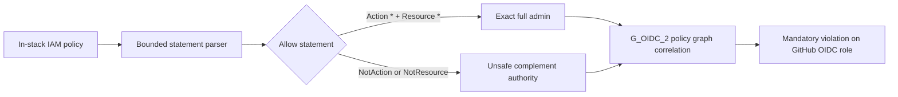

# Runbook — GitHub OIDC effective authority

**Runbook ID:** `github-oidc-effective-authority`
**Prefix:** `github-oidc-effective-authority`
**Status:** locally verified
**Target:** `kerberosmansour/hulumi`
**Finding:** `csf_27b2f83bd7908229e9a00792` / CWE-269
**Base revision:** `90c3b6b3dba208b35444368e8ec6e2adba1209dc`

## 1. Problem and outcome

`G_OIDC_2` recognizes AWS managed `AdministratorAccess` and one literal customer-policy shape,
`Allow` with exact `Action: "*"` and `Resource: "*"`. AWS IAM complement operators can express
nearly the same authority without that shape. In particular, `Allow + NotAction` grants every
applicable action except the named set; a repository actor who can obtain the correctly scoped OIDC
token can therefore receive near-administrator authority while the mandatory rule reports success.

The outcome is a fail-closed OIDC authority predicate: any `Allow` statement using `NotAction` or
`NotResource` is treated as an unsafe effective-administrator grant when the policy reaches a
GitHub-OIDC-trusted role through an already supported in-stack policy path. Existing exact full-admin
detection remains available to CIS 1.16 without changing its scope.

## 2. Stable interfaces and red lines

- `iamPolicyHasFullAdmin` retains its exact `Action: "*"` and `Resource: "*"` contract for CIS 1.16.
- `G_OIDC_2` uses a dedicated effective-authority predicate that includes exact full admin plus
  complement-operator allow statements.
- `Deny` statements using complement operators remain non-grants and do not trigger this rule.
- Ordinary scoped allowlist statements remain accepted.
- Policy documents never enter diagnostics; only resource and role URNs plus a bounded authority
  label are reported.
- External managed-policy versions and whole-account AWS effective permissions remain outside this
  preview-only rule.
- No dependency resolution, manifest, lockfile, version, publication, or live provider change is in
  scope.

## 3. Architecture

## 4. Milestone tracker

| Milestone | Title                                                     | Status           | Completed  | Evidence                                                |
| --------- | --------------------------------------------------------- | ---------------- | ---------- | ------------------------------------------------------- |
| M1        | Reject complement-operator authority on GitHub OIDC roles | locally verified | 2026-10-15 | `docs/slo/verify/github-oidc-effective-authority-m1.md` |

## 5. Formal verification

TLA+ and Kani are not required. The change is a deterministic TypeScript policy predicate and a
bounded Pulumi resource-graph correlation exercised through table-driven BDD fixtures.

## 5A. Measurement contract

- **Leading:** every supported inline and customer-managed attachment path reports `Allow` with
  `NotAction` or `NotResource` before deployment.
- **Lagging:** the merged-main Codex Security scan no longer reports administrator-equivalent
  complement policies or an equivalent OIDC authority bypass.
- **Guardrail:** existing CIS 1.16 exact-full-admin behavior and the 23-test G_OIDC_2 baseline stay
  compatible.
- **Readout:** focused/package/workspace tests, OSV, Semgrep, exact-head CI, and exact-main scan.

## 5B. Security contract

- **Threat:** a repository actor changes an in-stack policy to `Allow + NotAction` or `NotResource`,
  assumes the workflow-bound GitHub OIDC role, and exercises the broad residual authority.
- **Invariant:** no supported in-stack policy carrying an allow-side complement operator reaches a
  GitHub-OIDC-trusted role without one mandatory violation.
- **Failure behavior:** malformed documents remain outside this narrow predicate; AWS/provider
  validation and other fail-closed trust checks retain their existing behavior.
- **Proactive controls:** OWASP C3 input validation and C4 security by design; CWE-269 privilege
  management at the policy graph boundary.
- **Detected-work ledger:** `csf_27b2f83bd7908229e9a00792` = `fix_now`; no matching open GitHub issue
  was found on 2026-10-15.

## 5C. Outcome validation contract

- Parser layer: exact and complement statements are classified structurally, never by substring.
- Graph layer: role inline policies, `RolePolicy`, and in-stack customer-managed policy attachment
  paths all use the same effective-authority predicate.
- Negative controls: scoped allows, deny-side complements, unrelated roles, and unbound policies do
  not report.
- External layer: not applicable; no AWS call or managed-policy download occurs.

## 6. M1 contract — Reject complement-operator authority

### Files allowed to change

1. `docs/RUNBOOK-github-oidc-effective-authority.md`
2. `docs/slo/critique/github-oidc-effective-authority-m1.md`
3. `docs/slo/verify/github-oidc-effective-authority-m1.md`
4. `docs/slo/lessons/github-oidc-effective-authority-m1.md`
5. `docs/slo/completion/github-oidc-effective-authority-m1.md`
6. `packages/policies/src/aws/iam-policy.ts`
7. `packages/policies/src/github/g-oidc-2.ts`
8. `packages/policies/tests/github/g-oidc-2.test.ts`
9. `docs/components/g-oidc-2.md`

### Contract block

| Field               | Contract                                                                                                                        |
| ------------------- | ------------------------------------------------------------------------------------------------------------------------------- |
| Public surface      | Mandatory `G_OIDC_2` / `HULUMI-H4` preview policy behavior                                                                      |
| Compatibility       | Exact full-admin and AdministratorAccess detections remain; complement allows intentionally become violations                   |
| Error semantics     | One deduplicated mandatory violation per policy-resource/role/authority tuple                                                   |
| Exemplar            | Fail-closed `NotAction` / `NotResource` handling in CodeBuild and brokered PostgreSQL policy packs                              |
| Anti-exemplar       | Treating one literal wildcard shape as the complete effective-authority model                                                   |
| Data classification | Internal IAM policy metadata; diagnostics omit policy contents                                                                  |
| Abuse cases         | scalar/array `NotAction`; `NotResource`; combined complements; inline and customer-managed attachment paths; deny negative twin |
| Refactor budget     | One shared predicate, G_OIDC_2 call sites, focused tests, and operator docs                                                     |

### BDD acceptance

| ID  | Given                                                                                 | When                    | Then                                                                                         |
| --- | ------------------------------------------------------------------------------------- | ----------------------- | -------------------------------------------------------------------------------------------- |
| B1  | a GitHub OIDC role inline policy has `Allow + NotAction`                              | stack validation runs   | one mandatory violation names effective administrator authority                              |
| B2  | a linked `RolePolicy` has `Allow + NotResource`                                       | stack validation runs   | the linked OIDC role is reported                                                             |
| B3  | an in-stack customer-managed complement policy is attached by dependency or exact ARN | stack validation runs   | every supported attachment form reports                                                      |
| B4  | complement values are scalar, arrays, empty, malformed, or combined                   | stack validation runs   | presence on an `Allow` statement fails closed without evaluating attacker-selected semantics |
| B5  | a `Deny` statement uses `NotAction` or `NotResource`                                  | stack validation runs   | it is not treated as a permission grant                                                      |
| B6  | an ordinary scoped `Allow` uses only `Action` and `Resource`                          | stack validation runs   | the existing safe result is preserved                                                        |
| B7  | CIS 1.16 evaluates exact full admin                                                   | its existing suite runs | exact behavior is unchanged                                                                  |
| B8  | package/workspace/security gates run                                                  | verification completes  | all regressions pass with no dependency graph change                                         |

### Outcome scenario

`oc-github-oidc-effective-authority-1`: a repository change replaces a scoped deployment policy
with `Allow + NotAction`; preview fails before the role can be updated, while a scoped allowlist and
a deny-side complement remain accepted by this rule.

### Critical user journey

`cuj-github-oidc-effective-authority-1`: author policy → preview stack → correlate policy to exact OIDC
role → reject unsafe complement → replace with positive least-privilege action/resource allowlist →
preview passes.

### Forbidden shortcuts

- Do not stringify and substring-search policy documents.
- Do not attempt to calculate the semantic complement of attacker-controlled action/resource lists.
- Do not broaden CIS 1.16 silently through the shared exact-full-admin helper.
- Do not claim external managed policies or account-wide effective permissions were inspected.
- Do not add a dependency, suppression, live AWS call, or policy-document logging.

### Evidence log

| Gate                          | Expected                                      | Actual result                                                                                                                          |
| ----------------------------- | --------------------------------------------- | -------------------------------------------------------------------------------------------------------------------------------------- |
| Baseline focused              | 23 passing                                    | 23 passing at merged main                                                                                                              |
| RED BDD                       | B1–B4 fail before implementation              | 6 intended failures; 24 controls passed                                                                                                |
| GREEN BDD                     | B1–B8 pass                                    | 30/30 focused; 459/459 policy regressions                                                                                              |
| Policies build/typecheck/lint | pass                                          | passed                                                                                                                                 |
| Full workspace                | pass                                          | all 19 runnable projects passed build, typecheck, sequential tests, and lint                                                           |
| OSV                           | zero vulnerability and `MAL-*` results        | 2 lockfiles / 575 package occurrences / zero findings; SHA-256 `10c55dbf5e83d5268eb5fa37e826477ae5eb4a972a2fe38e0a6832f28be95df4`      |
| Semgrep                       | zero findings/errors                          | 210 rules / 3 TypeScript targets / zero findings or errors; SHA-256 `392565a0b5b2a7ead2695055555971cde30955093d5c3d38b96d8c26a03e1103` |
| Scope and dependency diff     | exact 9 paths; zero manifest/lockfile changes | passed locally; staging and diff checks remain before commit                                                                           |
| Exact-head CI                 | all applicable checks pass                    | pending                                                                                                                                |
| Exact-main Codex Security     | finding and equivalents absent                | pending                                                                                                                                |

### Definition of done

- B1–B8 and all existing G_OIDC_2/CIS regressions pass.
- Every supported in-stack permission edge uses the dedicated effective-authority predicate.
- Documentation distinguishes bounded preview detection from AWS effective-authorization analysis.
- Package/workspace, OSV, Semgrep, exact-head CI, and merged-main scan gates pass.

### Self-review gate

- Does the implementation stay within the exact file allow-list? Yes.
- Does every BDD scenario have direct runtime evidence? Yes.
- Are existing exact full-admin and deny-side semantics preserved? Yes.
- Are diagnostics bounded and free of policy documents? Yes.
- Did the dependency graph remain unchanged and pass OSV admission? Yes.
- Are exact-head CI and merged-main Codex Security still treated as pending closeout gates? Yes.
