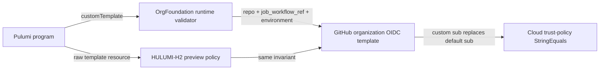

# Runbook: GitHub OIDC subject-template binding

Status: M1 confirmed by the user's standing instruction to continue autonomously with the SLO skills and defensive cybersecurity work only.
Runbook ID: `github-oidc-template-binding`
Finding: `csf_c6da8258f32fee3d38e20583` — custom GitHub OIDC templates may omit workflow and environment binding.
Base: `a86f92ac345239c30d750f5ad8ac853922ecf57a`.
Data classification: Internal configuration metadata; no secrets or token values are processed.

## 1. Metadata and stable interfaces

| Field                     | Value                                                                                                                                                                            |
| ------------------------- | -------------------------------------------------------------------------------------------------------------------------------------------------------------------------------- |
| Project                   | Hulumi                                                                                                                                                                           |
| Primary stack             | TypeScript, Pulumi GitHub provider, Pulumi CrossGuard                                                                                                                            |
| Packages                  | `@hulumi/baseline`, `@hulumi/policies`                                                                                                                                           |
| Prefix                    | `github-oidc-template-binding`                                                                                                                                                   |
| Focused tests             | `pnpm --filter @hulumi/baseline test -- --run tests/github/org-foundation.test.ts` and `pnpm --filter @hulumi/policies test -- --run tests/github/hulumi-hardening-pack.test.ts` |
| Package tests             | `pnpm --filter @hulumi/baseline test` and `pnpm --filter @hulumi/policies test`                                                                                                  |
| Build/typecheck/lint      | package build, typecheck and lint; repository format and license-boundary checks                                                                                                 |
| Dependency/security audit | `python3 scripts/osv-dependency-gate.py --output <report>` plus pinned Semgrep and secret-diff review                                                                            |
| New dependencies          | none                                                                                                                                                                             |
| Schema migration          | no                                                                                                                                                                               |
| Public interfaces         | `OidcSubTemplateConfig`, `assertOidcTemplateSafe`, `HULUMI_OIDC_DEFAULT_CLAIM_KEYS`, `HULUMI-H2-no-wildcard-oidc-template` remain named and import-compatible                    |

The custom-template option remains supported. Its validation becomes deliberately stricter: every custom template must contain `repo`, `job_workflow_ref`, and `environment`; additional unique GitHub-compatible claim keys remain accepted. `context` remains in Hulumi's default but is not required in a custom superset because the three load-bearing identities are repository, reusable workflow, and deployment environment.

## 2. Problem and architecture

`assertOidcTemplateSafe` currently accepts any nonempty list without a wildcard or a small set of shell metacharacters. A repo-only template is therefore sent to GitHub and replaces the entire subject format while losing reusable-workflow and environment identity. The preview policy repeats the same gap for raw Pulumi resources and trusts an `OrgFoundation` type-chain claim instead of validating its inputs.

GitHub documents that customizing claims replaces the complete `sub` format, and that `job_workflow_ref` is the claim used to bind a reusable workflow. GitHub's API additionally requires unique alphanumeric-or-underscore claim keys. The existing Hulumi threat model identifies `job_workflow_ref + environment` as the load-bearing cloud trust boundary.

Both enforcement paths inspect the same finite invariant. Neither path grants trust based on parent ancestry. No token is minted or parsed in this code.

## 3. Security and outcome contracts

### 3.1 Secure value and threat summary

- **Value wedge:** callers can add supported subject claims without accidentally deleting repository, reusable-workflow, or environment identity.
- **Operator readiness:** no credential or live organization is required for this pure input-validation milestone; exact-head CI and the existing credential-gated integration lane remain authoritative for publication.
- **Threat-model row:** `docs/slo/design/hulumi-github-threat-model.md`, boundary 2 and the new weak-custom-template row.
- **Bug class:** CWE-284 / missing authorization context through an underconstrained identity template.
- **Proactive controls:** C1 Implement Access Control; C3 Validate All Input and Handle Exceptions; C7 Enforce Digital Identity.
- **Security tests:** runtime component rejection, preview-policy rejection, raw/child parity, malformed/duplicate input, accepted safe superset, full package regression, OSV/Semgrep/secrets, exact-head CI, merged-main Codex Security.
- **Detected Work Ledger:** every discovered issue gets exactly one disposition: `fix_now`, `file_github_issue`, `operator_action`, `upstream_feedback`, or `accepted_risk`.

### 3.2 Measurement contract

This security fix changes a public validation outcome but adds no telemetry. Measurement is deterministic and local:

| Measure                                     | Target                                                   | Evidence owner/readout                |
| ------------------------------------------- | -------------------------------------------------------- | ------------------------------------- |
| unsafe runtime templates rejected           | every template missing any required identity axis        | M1 tests, same-day readout            |
| unsafe raw/child preview templates rejected | every malformed, missing-axis, or uninspectable resource | M1 policy tests, same-day readout     |
| compatibility                               | safe default and safe custom supersets pass              | M1 regression tests, same-day readout |
| merged-main finding recurrence              | target finding absent                                    | Codex Security, post-merge            |

### 3.3 Outcome validation contract

- `oc-github-oidc-template-binding-1`: Given a caller customizes the organization OIDC subject, when any repository/workflow/environment identity axis is omitted, then deployment fails before GitHub mutation and the error names the missing axis; and a safe superset is emitted unchanged.
- `cuj-github-oidc-template-binding-1`: caller config → `OrgFoundation` validation → Pulumi resource inputs.
- Cross-layer assertion: the same unsafe list is rejected by the component constructor and by `HULUMI-H2` when represented as a raw or component-child preview resource.

| Core capability                     | Result required |
| ----------------------------------- | --------------- |
| default OrgFoundation OIDC template | pass            |
| safe custom claim superset          | pass            |
| raw resource policy coverage        | pass            |
| scoped H2 suppression               | pass            |
| unrelated GitHub hardening rules    | pass            |

## 4. M1 — require repository, workflow, and environment identity

Status: `implementation_complete`; exact-head CI, merge, and merged-main Codex Security validation remain.
Started: 2026-10-15
Local verification completed: 2026-10-15
Refactor budget: No refactor permitted beyond the direct validation and documentation change.

### Contract block

| Contract item       | M1 decision                                                                                                                                                                                    |
| ------------------- | ---------------------------------------------------------------------------------------------------------------------------------------------------------------------------------------------- |
| Goal                | Eliminate weak custom OIDC subjects in both construction and preview validation.                                                                                                               |
| Exemplar            | `HULUMI_OIDC_DEFAULT_CLAIM_KEYS` and the fail-closed parsing patterns in `packages/policies/src/github/g-oidc-1.ts`.                                                                           |
| Anti-exemplar       | The current nonempty-only validator and H2's early return for claimed `OrgFoundation` ancestry.                                                                                                |
| AI tolerance        | N/A — no AI component.                                                                                                                                                                         |
| Data classification | Internal.                                                                                                                                                                                      |
| Proactive controls  | C1, C3, C7 as executable boundary checks.                                                                                                                                                      |
| Abuse acceptance    | `tm-hulumi-github-abuse-oidc-custom-missing-binding`: an org admin supplies `['repo']`; Hulumi must reject it before GitHub replaces the full subject format.                                  |
| Measurement         | §3.2 deterministic rejection/compatibility counts.                                                                                                                                             |
| Outcome/CUJ         | §3.3 `oc-*` and `cuj-*`.                                                                                                                                                                       |
| Resource bound      | One caller-supplied claim array, scanned linearly with no retained state. GitHub publishes uniqueness and character constraints but no list maximum; the API remains the final size authority. |
| Invariant           | accepted custom list contains each required key exactly once; every key matches `^[A-Za-z0-9_]+$`; additional unique keys are preserved.                                                       |
| Failure behavior    | synchronous descriptive error at construction, mandatory policy violation at preview; no fallback.                                                                                             |
| Compatibility       | public symbol names and default output remain unchanged; safe custom supersets remain accepted.                                                                                                |

### Allowed files

- `docs/RUNBOOK-github-oidc-template-binding.md`
- `docs/slo/critique/github-oidc-template-binding-m1.md`
- `docs/slo/verify/github-oidc-template-binding-m1.md`
- `docs/slo/lessons/github-oidc-template-binding-m1.md`
- `docs/slo/completion/github-oidc-template-binding-m1.md`
- `docs/slo/design/hulumi-github-threat-model.md`
- `packages/baseline/src/github/org-oidc-template.ts`
- `packages/baseline/src/github/org-foundation.args.ts`
- `packages/baseline/tests/github/org-foundation.test.ts`
- `packages/policies/src/github/hulumi-hardening-pack.rules.ts`
- `packages/policies/tests/github/hulumi-hardening-pack.test.ts`
- `docs/components/org-foundation.md`
- `docs/components/README.md`
- `packages/baseline/README.md`
- `packages/policies/README.md`

### BDD acceptance

| ID       | Given/when                                                                                                          | Then                                                                          |
| -------- | ------------------------------------------------------------------------------------------------------------------- | ----------------------------------------------------------------------------- |
| BDD-M1-1 | default OrgFoundation configuration                                                                                 | exact existing `repo, context, job_workflow_ref, environment` list is emitted |
| BDD-M1-2 | custom list contains required keys plus unique supported extras in any order                                        | runtime and policy accept it and preserve the caller's order                  |
| BDD-M1-3 | custom list omits `repo`, `job_workflow_ref`, or `environment`                                                      | runtime throws and preview policy reports the exact missing axes              |
| BDD-M1-4 | list is empty, non-array, contains a non-string, duplicate, wildcard, punctuation, whitespace, or control character | runtime/policy fail closed; no GitHub resource is treated as compliant        |
| BDD-M1-5 | unsafe template is a child of a claimed `OrgFoundation` component or has a forged logical name                      | H2 still validates the actual `includeClaimKeys` and reports it               |
| BDD-M1-6 | an exact scoped H2 suppression applies                                                                              | existing suppression behavior remains effective                               |
| BDD-M1-7 | unrelated GitHub policy/component tests run                                                                         | no unrelated regression                                                       |

### Evidence log

| Evidence                            | Required result                                                        |
| ----------------------------------- | ---------------------------------------------------------------------- |
| Repo hygiene                        | task branch from exact `origin/main`, clean before edits               |
| Baseline focused tests              | green before RED changes                                               |
| RED                                 | new BDDs fail for missing invariant, not compile/setup error           |
| Focused green                       | both component and policy files green                                  |
| Package regression                  | baseline and policies packages green                                   |
| Build/typecheck/lint/format/license | all green                                                              |
| Dependency                          | no manifest/lock diff; pinned OSV gate 0 vulnerable and 0 MAL          |
| Static/security                     | pinned Semgrep 0 findings/errors; secret diff clean                    |
| GitHub                              | signed+DCO exact-head CI green                                         |
| Post-merge                          | exact merged-main Codex Security scan completed; target finding absent |

### Forbidden shortcuts and out of scope

- No wildcard, missing-axis, malformed-array, or uninspectable-resource fallback.
- No trust based on URN ancestry, logical names, tags, or component claims.
- No silent sorting/deduplication that changes the requested subject order.
- No dependency, lockfile, package-version, release, GitHub API mutation, or live credential change.
- No changes to cloud-provider IAM trust parsing, repository opt-in behavior, suppression schema, CodeQL, Semgrep rules, or secret-scanning patterns.

### Definition of done

All BDD and outcome scenarios pass; every evidence row has an actual result; documentation and threat model state the required identity axes; no allow-list drift exists; the signed exact-head PR is green and merged under standing authorization; a merged-main Codex Security scan confirms the target finding absent.

### Local result

- Component and preview-policy validators now require `repo`, `job_workflow_ref`, and `environment` exactly once while preserving valid extra claims and caller order.
- Runtime and policy tests cover every missing identity axis, empty/malformed/duplicate claims, uninspectable resources, raw resources, component children, forged logical names, defaults, safe supersets, and scoped suppression.
- Focused suites passed 24/24 and 45/45; package suites passed 190 with 14 skipped and one todo, and 355/355 respectively.
- Full workspace build, typecheck, test, lint, formatting, and license-boundary checks passed.
- Pinned OSV and Semgrep scans passed with zero vulnerable or malicious package occurrences and zero findings/errors; the diff contains no dependency graph change or high-confidence secret match.
