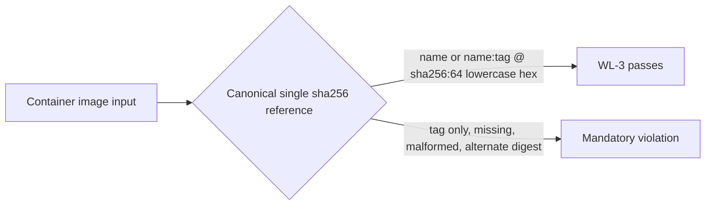

# Runbook — Kubernetes immutable image digests

**Runbook ID:** `k8s-immutable-image-digests`
**Prefix:** `k8s-immutable-image-digests`
**Status:** locally verified
**Target:** `kerberosmansour/hulumi`
**Finding:** `csf_96d255d71ece4e202037301b` / CWE-494
**Base revision:** `23c877de8133299f55576a0b8f1486a9d35eb181`

## 1. Problem and outcome

`HULUMI-K8S-WL-3` rejects no-tag, `latest`, and `edge` image references but calls every other tag immutable. Registry tags, including semantic-version tags, can be repointed. A workload can therefore pass the mandatory policy and later resolve to different bytes without a Pulumi program change.

The outcome is a content-addressed policy boundary: each container and init-container image must use one canonical `@sha256:` digest followed by exactly 64 lowercase hexadecimal digits. Tags may precede the digest because the digest, rather than the tag, selects the content.

## 2. Stable interfaces and red lines

- Preserve public rule ID `HULUMI-K8S-WL-3` and exported symbol `k8sWl3NoLatestImage`.
- Apply the same digest requirement to regular and init containers on every already-supported pod-owning resource.
- Reject every tag-only, no-tag, empty, missing, non-string, malformed, truncated, alternate-algorithm, uppercase/non-canonical, whitespace-bearing, multi-`@`, or suffix-garbage reference.
- Do not echo the image reference in diagnostics because registry references can contain sensitive internal names or accidental credentials.
- Do not add registry lookups, image pulls, dependency changes, Patch-resource coverage, or other Kubernetes rule changes.

## 3. Architecture

## 4. Milestone tracker

| Milestone | Title                                   | Status           | Completed  | Evidence                                            |
| --------- | --------------------------------------- | ---------------- | ---------- | --------------------------------------------------- |
| M1        | Require canonical SHA-256 image digests | locally verified | 2026-10-15 | `docs/slo/verify/k8s-immutable-image-digests-m1.md` |

## 5. Formal verification

TLA+ and Kani are not required. This is a deterministic TypeScript grammar predicate exercised through the production Pulumi resource policy with table-driven boundary cases.

## 5A. Measurement contract

- **Leading:** every protected container and init-container reference lacking a canonical digest produces one mandatory violation.
- **Lagging:** the exact merged-main Codex Security scan no longer reports tag-only images as immutable or an equivalent WL-3 bypass.
- **Guardrail:** the 27-test focused baseline and every unrelated WL-1/WL-2/WL-4/SVC-1 behavior remain green.
- **Readout:** focused/package/workspace tests, OSV, Semgrep, exact-head CI, and exact-main scan.

## 5B. Security contract

- **Threat:** an attacker or compromised registry repoints a tag after preview, causing deployment of bytes that were not selected by the reviewed infrastructure program.
- **Invariant:** the policy passes an image only when the reviewed string itself contains one exact canonical SHA-256 content digest.
- **Failure behavior:** missing, uninspectable, or non-canonical image inputs fail closed with a bounded diagnostic that omits the reference value.
- **Proactive controls:** OWASP C3 input validation and C4 security by design; CWE-494 download of code without integrity check.
- **Detected-work ledger:** `csf_96d255d71ece4e202037301b` = `fix_now`; no matching open GitHub issue was found on 2026-10-15.

## 5C. Outcome validation contract

- Parser layer: require `^[^@\\s]+@sha256:[a-f0-9]{64}$` and reject every other value.
- Resource layer: cover both container arrays through the existing authoritative PodSpec extractor.
- Negative controls: canonical untagged-digest and tag-plus-digest references pass, including a registry host port.
- External layer: not applicable; no registry or cluster call occurs.

## 6. M1 contract — Require canonical SHA-256 image digests

### Files allowed to change

1. `docs/RUNBOOK-k8s-immutable-image-digests.md`
2. `docs/slo/critique/k8s-immutable-image-digests-m1.md`
3. `docs/slo/verify/k8s-immutable-image-digests-m1.md`
4. `docs/slo/lessons/k8s-immutable-image-digests-m1.md`
5. `docs/slo/completion/k8s-immutable-image-digests-m1.md`
6. `packages/policies/src/k8s/hulumi-hardening-pack.ts`
7. `packages/policies/tests/k8s/hulumi-k8s-hardening-pack.test.ts`
8. `packages/policies/tests/k8s/policy-pack-runtime.test.ts`
9. `docs/components/README.md`

### Contract block

| Field               | Contract                                                                                                                      |
| ------------------- | ----------------------------------------------------------------------------------------------------------------------------- |
| Public surface      | Mandatory `HULUMI-K8S-WL-3` preview behavior; public ID and export retained                                                   |
| Compatibility       | Tag-only images intentionally become violations; valid canonical digest references stay accepted                              |
| Error semantics     | One bounded violation per non-canonical container or init-container image                                                     |
| Exemplar            | `registry.example.com:5000/team/api:1.2.3@sha256:<64 lowercase hex>`                                                          |
| Anti-exemplar       | Calling a semantic-version tag immutable without registry-enforced evidence                                                   |
| Data classification | Internal image names; diagnostics omit the full image reference                                                               |
| Abuse cases         | tag repointing, malformed/truncated/alternate digests, suffix garbage, whitespace, multiple separators, missing/unknown input |
| Refactor budget     | One local grammar predicate, focused tests, and operator documentation                                                        |

### BDD acceptance

| ID  | Given                                                                                                                            | When                           | Then                                                                             |
| --- | -------------------------------------------------------------------------------------------------------------------------------- | ------------------------------ | -------------------------------------------------------------------------------- |
| B1  | an image uses a semantic-version or arbitrary tag without a digest                                                               | WL-3 evaluates it              | one mandatory violation is reported                                              |
| B2  | an image has no tag, `latest`, `edge`, an empty value, or a missing/non-string value                                             | WL-3 evaluates it              | it fails closed                                                                  |
| B3  | a reference has a truncated digest, alternate algorithm, uppercase/non-canonical hex, whitespace, multiple `@`, or trailing data | WL-3 evaluates it              | it fails closed                                                                  |
| B4  | a reference is `name@sha256:<64 lowercase hex>`                                                                                  | WL-3 evaluates it              | it passes                                                                        |
| B5  | a host-port and tag precede the same exact digest                                                                                | WL-3 evaluates it              | it passes                                                                        |
| B6  | an init container carries a tag-only reference                                                                                   | WL-3 evaluates it              | the init container is reported                                                   |
| B7  | a violation is rendered                                                                                                          | diagnostic output is inspected | it identifies the container/URN and digest requirement without copying the image |
| B8  | package/workspace/security gates run                                                                                             | verification completes         | all regressions pass with no dependency graph change                             |

### Outcome scenario

`oc-k8s-immutable-image-digests-1`: a deployment changes from a reviewed digest to the same apparent version tag without the digest; preview fails before Kubernetes can resolve repointed registry content.

### Critical user journey

`cuj-k8s-immutable-image-digests-1`: author workload → preview → reject tag-only reference → resolve the intended image digest through the separate trusted build/release process → pin `@sha256:<64 hex>` → preview passes.

### Evidence log

| Gate                          | Expected                                                                                       | Actual result                                                                                                                               |
| ----------------------------- | ---------------------------------------------------------------------------------------------- | ------------------------------------------------------------------------------------------------------------------------------------------- |
| Baseline focused              | 27 passing                                                                                     | 27 passing at exact merged main                                                                                                             |
| RED BDD                       | B1–B3, B6–B7 fail before implementation                                                        | 15 intended failures; 27 controls passed                                                                                                    |
| GREEN BDD                     | B1–B8 pass                                                                                     | 42/42 focused; runtime 2/2; policies 474/474                                                                                                |
| Policies build/typecheck/lint | pass                                                                                           | passed                                                                                                                                      |
| Full workspace                | pass                                                                                           | all 19 runnable projects passed build, typecheck, sequential tests, and lint                                                                |
| OSV                           | zero vulnerability and `MAL-*` results                                                         | baseline: 2 lockfiles / 575 package occurrences / zero findings; SHA-256 `10c55dbf5e83d5268eb5fa37e826477ae5eb4a972a2fe38e0a6832f28be95df4` |
| Semgrep                       | zero findings/errors                                                                           | 210 rules / 2 TypeScript targets / zero findings or errors; SHA-256 `c07fede0bb1423884f7d9f793cf37c00541471f793c9caa126c46a949f9df47a`      |
| Scope and dependency diff     | exact 9 paths across the primary and auxiliary AgentBus leases; zero manifest/lockfile changes | passed locally; staging and diff checks remain before commit                                                                                |
| Exact-head CI                 | all applicable checks pass                                                                     | pending                                                                                                                                     |
| Exact-main Codex Security     | finding and equivalents absent                                                                 | pending                                                                                                                                     |

### Definition of done

- B1–B8 and all existing Kubernetes policy regressions pass.
- WL-3 accepts only one exact canonical SHA-256 digest reference on every inspected container.
- Documentation no longer claims that a semantic-version tag is immutable.
- Package/workspace, OSV, Semgrep, exact-head CI, and merged-main scan gates pass.

### Self-review gate

- Does the implementation stay within the explicit primary and auxiliary file leases? Yes.
- Does every BDD scenario have direct production-policy runtime evidence? Yes.
- Are the public rule ID and exported symbol preserved? Yes.
- Are valid tag-plus-digest and host-port references covered by negative controls? Yes.
- Do diagnostics omit the image reference while giving an actionable digest requirement? Yes.
- Did the dependency graph remain unchanged and pass OSV admission? Yes.
- Are exact-head CI and merged-main Codex Security still treated as pending closeout gates? Yes.
