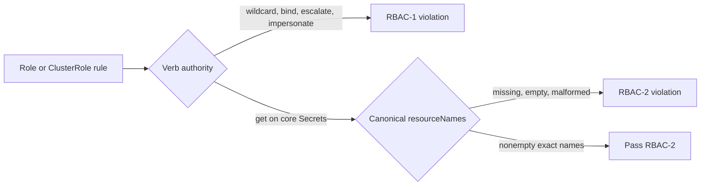

# Runbook — Kubernetes RBAC authority bounds

**Runbook ID:** `k8s-rbac-authority-bounds`
**Prefix:** `k8s-rbac-authority-bounds`
**Status:** locally verified; exact-head and merged-main gates pending
**Target:** `kerberosmansour/hulumi`
**Findings:** `csf_22d32a06fdca073efcb726d3` / CWE-269 and `csf_1880772fe33ed55be7f48f50` / CWE-284
**Base revision:** `fe9ddc9346e7266edd239ab271e4a612e982da86`

## 1. Problem and outcome

The mandatory RBAC pack blocks wildcard verbs but accepts the explicit Kubernetes privilege-escalation verbs `bind`, `escalate`, and `impersonate`. It also blocks `list` and `watch` on Secrets while allowing unscoped `get`, which permits retrieval of every known or guessed Secret name in scope.

The outcome is a bounded least-privilege contract: RBAC-1 rejects wildcard and explicit escalation verbs on every Role and ClusterRole rule; RBAC-2 permits `get` on core Secrets only when `resourceNames` is a nonempty array of canonical exact names. Existing public rule IDs, suppression behavior, RBAC-3, ordinary resource reads, and exact named-Secret reads remain stable.

## 2. Stable interfaces and red lines

- Preserve public rule IDs and exported policy symbols.
- RBAC-1 rejects any rule containing `*`, `bind`, `escalate`, or `impersonate` in `verbs`.
- RBAC-2 retains the existing `list`, `watch`, and `*` rejection for core Secrets and also rejects `get` unless every `resourceNames` entry is a nonempty, trimmed exact name other than `*`.
- Diagnostics identify the authority class and Role/ClusterRole URN without copying Secret names or unrelated rule contents.
- Do not change RBAC-3, suppression schema, resource/binding correlation, Patch-resource matching, dependency graphs, or live cluster state.

## 3. Architecture

## 4. Milestone tracker

| Milestone | Title                                   | Status           | Completed | Evidence                                          |
| --------- | --------------------------------------- | ---------------- | --------- | ------------------------------------------------- |
| M1        | Bound escalation verbs and Secret reads | locally verified | —         | `docs/slo/verify/k8s-rbac-authority-bounds-m1.md` |

## 5. Formal verification

TLA+ and Kani are not required. The change is deterministic TypeScript policy logic exercised through production Pulumi resource-validation functions with table-driven positive and negative cases.

## 5A. Measurement contract

- **Leading:** every wildcard/explicit escalation verb and every unscoped Secret read produces the intended mandatory violation.
- **Lagging:** the exact merged-main Codex Security scan no longer reports either finding or an equivalent RBAC authority bypass.
- **Guardrail:** the 8-test focused baseline, RBAC-3, suppressions, ordinary resource reads, and exact named-Secret reads remain green.
- **Readout:** focused/package/workspace tests, OSV, Semgrep, exact-head CI, and exact-main scan.

## 5B. Security contract

- **Threat A:** a workload principal creates or updates roles/bindings, escalates a role beyond its own permissions, or impersonates a user/group/service account while avoiding the wildcard check.
- **Threat B:** a workload with unscoped `get` on Secrets retrieves any Secret whose name it learns or guesses without needing `list` or `watch`.
- **Invariant:** escalation verbs are never accepted by RBAC-1; Secret reads require canonical exact resource names under RBAC-2.
- **Failure behavior:** absent, empty, malformed, wildcard-like, or whitespace-altered Secret name bounds fail closed.
- **Detected-work ledger:** `csf_22d32a06fdca073efcb726d3` and `csf_1880772fe33ed55be7f48f50` = `fix_now`; no matching open GitHub issue was found on 2026-10-15.

## 5C. Outcome validation contract

- Verb layer: inspect the exact verbs array and reject the bounded escalation set without resource-name inference.
- Secret layer: apply only to core-group Secrets (including resource wildcard) and require exact name bounds for `get`.
- Negative controls: Pod read verbs, named Secret reads, RBAC-3 non-admin bindings, and existing reasoned suppressions preserve behavior.
- External layer: not applicable; no Kubernetes API or authorization review call occurs.

## 6. M1 contract — Bound escalation verbs and Secret reads

### Files allowed to change

1. `docs/RUNBOOK-k8s-rbac-authority-bounds.md`
2. `docs/slo/critique/k8s-rbac-authority-bounds-m1.md`
3. `docs/slo/verify/k8s-rbac-authority-bounds-m1.md`
4. `docs/slo/lessons/k8s-rbac-authority-bounds-m1.md`
5. `docs/slo/completion/k8s-rbac-authority-bounds-m1.md`
6. `packages/policies/src/k8s/rbac-pack.ts`
7. `packages/policies/tests/k8s/rbac-pack.test.ts`
8. `docs/components/k8s-rbac-policy-pack.md`
9. `docs/cookbooks/policy-pack-rollout.md`

### Contract block

| Field               | Contract                                                                                                      |
| ------------------- | ------------------------------------------------------------------------------------------------------------- |
| Public surface      | Mandatory RBAC-1/RBAC-2 preview behavior; public IDs and exports retained                                     |
| Compatibility       | Explicit escalation and unscoped Secret reads intentionally become violations; scoped reads stay accepted     |
| Error semantics     | At most one RBAC-1 and one RBAC-2 violation per offending rule                                                |
| Exemplar            | `get` on `secrets` with `resourceNames: ["application-credentials"]`                                          |
| Anti-exemplar       | Treating explicit escalation verbs as safe merely because `verbs` contains no wildcard                        |
| Data classification | Internal Role/ClusterRole metadata; diagnostics omit Secret names and complete rules                          |
| Abuse cases         | explicit bind/escalate/impersonate; mixed verb sets; absent/empty/blank/wildcard/malformed Secret name bounds |
| Refactor budget     | Two local predicates, focused tests, and operator documentation                                               |

### BDD acceptance

| ID  | Given                                                                             | When                   | Then                                                 |
| --- | --------------------------------------------------------------------------------- | ---------------------- | ---------------------------------------------------- |
| B1  | a Role rule contains explicit `bind`                                              | RBAC-1 evaluates it    | one mandatory violation is reported                  |
| B2  | a ClusterRole rule contains explicit `escalate`                                   | RBAC-1 evaluates it    | one mandatory violation is reported                  |
| B3  | a rule contains explicit `impersonate`, alone or among ordinary verbs             | RBAC-1 evaluates it    | one mandatory violation is reported                  |
| B4  | a rule contains wildcard verbs                                                    | RBAC-1 evaluates it    | existing rejection remains                           |
| B5  | a core Secret rule grants `get` without canonical exact `resourceNames`           | RBAC-2 evaluates it    | one mandatory violation is reported                  |
| B6  | a core Secret rule grants `get` with one or more canonical exact names            | RBAC-2 evaluates it    | it passes                                            |
| B7  | ordinary Pod reads, reasoned suppressions, and non-admin RBAC-3 bindings evaluate | all rules run          | their existing results are preserved                 |
| B8  | package/workspace/security gates run                                              | verification completes | all regressions pass with no dependency graph change |

### Outcome scenario

`oc-k8s-rbac-authority-bounds-1`: a workload role replaces wildcard verbs with explicit `bind` or keeps only unscoped Secret `get`; preview still fails until escalation verbs are removed and Secret access is bound to exact names.

### Critical user journey

`cuj-k8s-rbac-authority-bounds-1`: author least-privilege Role → preview → reject escalation/unscoped Secret authority → enumerate intended Secret names → preview passes → bind only the intended workload subject.

### Evidence log

| Gate                          | Expected                                      | Actual result                                                                                                                                       |
| ----------------------------- | --------------------------------------------- | --------------------------------------------------------------------------------------------------------------------------------------------------- |
| Baseline focused              | 8 passing                                     | 8 passing at exact merged main                                                                                                                      |
| RED BDD                       | B1–B3 and B5 fail before implementation       | 11 intended failures; 8 existing controls passed                                                                                                    |
| GREEN BDD                     | B1–B8 pass                                    | 19/19 focused; 485/485 policy-package tests                                                                                                         |
| Policies build/typecheck/lint | pass                                          | passed                                                                                                                                              |
| Full workspace                | pass                                          | 19 runnable projects; build/typecheck/lint passed; 1,344 tests passed                                                                               |
| OSV                           | zero vulnerability and `MAL-*` results        | final: OSV 2.7.0, 2 lockfiles / 575 package occurrences / zero findings; SHA-256 `10c55dbf5e83d5268eb5fa37e826477ae5eb4a972a2fe38e0a6832f28be95df4` |
| Semgrep                       | zero findings/errors                          | 210 rules / 2 TypeScript targets / zero findings or errors; SHA-256 `a4547366556e148eb79525b55b5aa1bf74dcbe2b99028f123e043292b7689259`              |
| Scope and dependency diff     | exact 9 paths; zero manifest/lockfile changes | passed locally; final staged check remains                                                                                                          |
| Exact-head CI                 | all applicable checks pass                    | pending                                                                                                                                             |
| Exact-main Codex Security     | both findings and equivalents absent          | pending                                                                                                                                             |

### Definition of done

- B1–B8 and all existing RBAC regressions pass.
- RBAC-1 rejects wildcard and explicit escalation verbs; RBAC-2 requires exact Secret names for `get`.
- Documentation states the precise accepted and rejected shapes without overstating whole-cluster authorization analysis.
- Package/workspace, OSV, Semgrep, exact-head CI, and merged-main scan gates pass.
