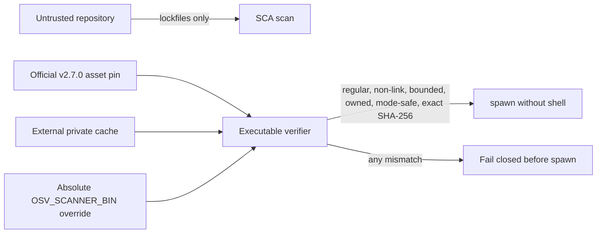

# Runbook: OSV scanner cache integrity

Status: M1 locally implemented and verified; exact-head CI, merge, and merged-main Codex Security verification remain.
Runbook ID: `osv-scanner-cache-integrity`
Finding: `csf_f8669dde43f27c6a64744256` — the SCA CLI executes a predictable repository-local cached OSV binary after an existence-only check.
Base: `dbadf79346705c513bbb8d5dbaedd87b512a1db2`.
Data classification: Public dependency metadata and local executable paths; no credentials or package installation.

## 1. Metadata and stable interfaces

| Field                     | Value                                                                                                               |
| ------------------------- | ------------------------------------------------------------------------------------------------------------------- |
| Project                   | Hulumi                                                                                                              |
| Primary stack             | TypeScript, Node test runner, OSV-Scanner                                                                           |
| Package                   | `@hulumi/sca-brain`                                                                                                 |
| Prefix                    | `osv-scanner-cache-integrity`                                                                                       |
| Focused test              | `npm --prefix tools/sca test`                                                                                       |
| Build/lint/format         | `npm --prefix tools/sca run build`, `lint`, and `format`                                                            |
| Dependency/security audit | `python3 scripts/osv-dependency-gate.py --output <report>` plus pinned Semgrep and secret-diff review               |
| New dependencies          | none                                                                                                                |
| Stable interface          | `ensureScannerBinary(rootDir)` remains callable; scan/dependency-review output schemas and routing remain unchanged |
| Scanner pin               | Official OSV-Scanner v2.7.0, commit `bfe2f84abd2f09fe0b83ba7f6dad40d296762f40`, platform asset SHA-256 pins         |

M1 treats the OSV executable as trusted computing-base material. It may never be selected from the scanned repository or from unverified `PATH` discovery. A cached or explicitly supplied binary must match the official pinned platform asset on every use.

## 2. Problem and architecture

`ensureScannerBinary(rootDir)` currently creates `.cache/osv-scanner` beneath the repository and returns any pre-existing file there without checking its type, links, owner, permissions, size, or digest. That path is passed directly to `spawn`. An attacker who authors a repository presented to the CLI can therefore plant the expected filename and execute code under the scanner user's identity.

The default cache lives outside the target checkout in a canonical operator cache directory. Its directory is private and owned by the current user. Existing files are rehashed on every use. Downloads are size-bounded, hash-checked before staging, written privately through a unique staging directory, renamed, and then verified again.

## 3. Security and outcome contracts

- **Value wedge:** dependency scanning cannot become the first arbitrary-code execution step against an untrusted checkout.
- **Threat class:** CWE-353 / missing support for integrity check.
- **Proactive controls:** C3 Validate All Input and Handle Exceptions; C6 Implement Digital Identity; C10 Handle All Errors and Exceptions.
- **Abuse case:** `tm-hulumi-sca-repository-scanner-substitution` — a repository author plants `.cache/osv-scanner/<version>/<asset>` and a trusted operator invokes the SCA CLI without a verified scanner.
- **Measurement:** wrong-digest files, symlinked files/directories, repository-local cache roots, relative/unpinned overrides, and a fake PATH scanner all fail before execution; exact-head and merged-main scans must remove the source finding.
- **Provider evidence:** the official Google OSV-Scanner v2.7.0 release is current and publishes SHA-256 values for six platform binaries; the existing Python dependency-admission gate carries the same independently matched pins.

### Outcome validation

- `oc-osv-scanner-cache-integrity-1`: Given a hostile checkout containing the expected scanner cache path, when the SCA CLI resolves its scanner, then repository content is ignored and no attacker-controlled file is executed.
- `oc-osv-scanner-cache-integrity-2`: Given a cached or explicitly supplied scanner, when its bytes, file type, links, owner, mode, or size do not match the pinned contract, then resolution fails closed before spawn.
- `cuj-osv-scanner-cache-integrity-1`: dependency-review request → external cache resolution or bounded official download → exact digest verification → scanner execution.

## 4. M1 — verify every scanner executable before spawn

Status: `locally verified`.
Started: 2026-10-15
Refactor budget: scanner bootstrap only, its security-boundary tests, SCA operator documentation, and SLO evidence.

### Contract block

| Contract item       | M1 decision                                                                                                                                                  |
| ------------------- | ------------------------------------------------------------------------------------------------------------------------------------------------------------ |
| Goal                | Remove the target repository from executable selection and verify the pinned scanner on every use.                                                           |
| Exemplar            | `scripts/osv-dependency-gate.py`: externalized trust boundary, link/type/size checks, exact official hashes, atomic staging, and re-verification.            |
| Anti-exemplar       | `exists(destination) → return destination` under the untrusted checkout.                                                                                     |
| Data classification | Public release asset bytes, SHA-256 values, and local paths.                                                                                                 |
| Abuse acceptance    | Wrong digest, symlink, non-file, oversized file, foreign owner, unsafe mode, in-repository cache, relative override, and fake PATH scanner all fail closed.  |
| Resource bound      | Maximum 64 MiB download and hash input; one linear SHA-256 pass per use; no recursive repository scan in bootstrap.                                          |
| Invariant           | Every command returned by `ensureScannerBinary` is an absolute path outside the target repository and matches the current platform's official v2.7.0 digest. |
| Failure behavior    | Preserve the suspect file for investigation, emit a bounded error without file contents, and never fall back to PATH or redownload over a corrupt cache.     |
| Compatibility       | Scan schemas, finding routing, CLI arguments, dependency-review behavior, and the one-argument bootstrap call remain stable.                                 |

### Allowed files

- `docs/RUNBOOK-osv-scanner-cache-integrity.md`
- `docs/slo/critique/osv-scanner-cache-integrity-m1.md`
- `docs/slo/verify/osv-scanner-cache-integrity-m1.md`
- `docs/slo/lessons/osv-scanner-cache-integrity-m1.md`
- `docs/slo/completion/osv-scanner-cache-integrity-m1.md`
- `tools/sca/src/cli/scan.ts`
- `tools/sca/test/security-boundaries.test.ts`
- `tools/sca/README.md`

### BDD acceptance

| ID       | Given/when                                                               | Then                                                                      |
| -------- | ------------------------------------------------------------------------ | ------------------------------------------------------------------------- |
| BDD-M1-1 | wrong-digest executable exists at the external cache destination         | resolution rejects it and does not download over or execute it            |
| BDD-M1-2 | cache destination or a cache component is a symbolic link                | resolution rejects it before reading or spawning the link target          |
| BDD-M1-3 | `OSV_SCANNER_BIN` is relative, repository-local, or has the wrong digest | resolution fails closed                                                   |
| BDD-M1-4 | a fake `osv-scanner` is available on PATH                                | it is never invoked; only the pinned absolute cache/download path is used |
| BDD-M1-5 | a verified file is changed after one successful verification             | the next verification rehashes and rejects it                             |
| BDD-M1-6 | cache root is inside the scanned repository                              | resolution rejects the configuration                                      |
| BDD-M1-7 | package regressions and no-manifest-diff checks run                      | existing SCA behavior remains green with no dependency graph change       |

### Evidence log

| Evidence        | Required result                                                                       |
| --------------- | ------------------------------------------------------------------------------------- |
| Repo hygiene    | task branch starts from exact `origin/main`; clean before edits                       |
| Baseline        | SCA package test/build/lint/format green before RED changes                           |
| RED             | new bootstrap BDDs fail only for the missing integrity controls                       |
| Focused/package | complete SCA package suite/build/lint/format green                                    |
| Dependency      | no manifest/lock diff; pinned OSV gate reports 0 vulnerable and 0 `MAL-*` occurrences |
| Static/security | pinned Semgrep 0 findings/errors; secret diff clean                                   |
| GitHub          | signed+DCO exact-head CI green                                                        |
| Post-merge      | exact merged-main Codex Security scan completed; source finding absent                |

### Local result

- Ten hostile-boundary scenarios pass: wrong digest, final-file link, parent-directory link, fake PATH scanner, relative override, repository-local override, post-verification mutation, unsafe executable mode, unsafe cache-directory mode, and repository-local cache root.
- The actual v2.7.0 Darwin arm64 release downloaded into a private external cache, returned commit `bfe2f84abd2f09fe0b83ba7f6dad40d296762f40`, and passed a second cache-hit re-verification.
- SCA package tests passed 26/26; package build, lint, and format passed. Workspace build, typecheck, test, lint, and format passed across 19 projects.
- Official OSV-Scanner 2.7.0 scanned 575 package occurrences in two unchanged lockfiles with zero advisories and zero `MAL-*`. Semgrep 1.156.0 ran 74 rules over the two changed TypeScript files with zero findings or errors.

### Forbidden shortcuts and out of scope

- No checksum bypass, unverified PATH fallback, repository-local executable cache, link following, weak hash, executable content logging, or automatic deletion of suspect evidence.
- No dependency, package manifest, lockfile, version, publication, live credential, finding routing, remediation, scope-classification, or output-schema change.
- No fix for the separate stale-output, manifest-containment, enrichment, or remediation findings in this milestone.

### Definition of done

All BDD and outcome scenarios pass; scanner pins match the official v2.7.0 checksum asset and the repository Python gate; no allow-list drift exists; the signed exact-head PR is green and merged under standing authorization; an exact merged-main Codex Security scan confirms the source finding is absent.
