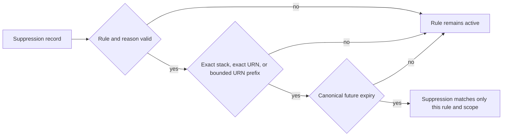

# Runbook — Policy suppression integrity

**Runbook ID:** `policy-suppression-integrity`
**Prefix:** `policy-suppression-integrity`
**Status:** locally verified; external closeout pending
**Target:** `kerberosmansour/hulumi`
**Finding:** `csf_4617d83ac6d0d2c36b2638f8` / CWE-20
**Base revision:** `f03d63741757cdc37eb6efb8f895b5720df646b9`

## 1. Problem and outcome

The shared suppression matcher currently treats omitted scope and expiry as
valid, accepts invalid dates, and accepts the global `*` scope. A malformed
entry can therefore disable a mandatory policy everywhere and forever even
though operator documentation describes scoped, justified, expiring
exceptions.

The outcome is one fail-closed contract used by every existing policy pack:
the rule ID must match, the reason must be nonblank, scope must be the exact
resource URN, a non-global trailing-prefix scope, or the exact literal `stack`,
and expiry must be a canonical future ISO date or UTC timestamp. Public rule
IDs, matcher exports, policy meanings, and the `SuppressionMatch` result shape
remain stable.

## 2. Stable interfaces and red lines

- Preserve `matchSuppression`, `Suppression`, `SuppressionMatch`, all public
  rule IDs, and all existing policy-pack exports.
- Preserve exact resource scopes and the existing single trailing-`*` prefix
  mechanism when the prefix itself is a nonempty Pulumi URN.
- Require stack policies to use the explicit exact scope `stack`.
- Reject omitted, blank, global, internally wildcarded, question-mark, or
  mismatched scopes.
- Require a nonblank reason and a canonical future `YYYY-MM-DD`,
  `YYYY-MM-DDTHH:mm:ssZ`, or millisecond UTC timestamp.
- Do not add an owner field, audit sink, severity inference, new glob language,
  dependency, version, publication, or cloud mutation.

## 3. Architecture

## 4. Milestone tracker

| Milestone | Title                                      | Status           | Completed | Evidence                                             |
| --------- | ------------------------------------------ | ---------------- | --------- | ---------------------------------------------------- |
| M1        | Require bounded, justified, expiring rules | locally verified | —         | `docs/slo/verify/policy-suppression-integrity-m1.md` |

## 5. Formal verification

TLA+ and Kani are not required. This is a deterministic TypeScript predicate
over a small partition of string and date shapes, exercised directly and
through each policy-pack family.

## 5A. Measurement contract

- **Leading:** every malformed reason, scope, expiry, rule, or URN combination
  returns `{ suppressed: false }`.
- **Lagging:** the exact merged-main Codex Security scan no longer reports a
  malformed, permanent, or global suppression bypass or an equivalent.
- **Guardrail:** exact resource, non-global prefix, and explicit stack
  suppressions remain usable with canonical future expiry values.
- **Readout:** direct BDD, focused/package/workspace tests, OSV, Semgrep,
  exact-head CI, and exact-main scan.

## 5B. Security contract

- **Threat:** an IaC author supplies a suppression record that omits scope or
  expiry, uses `*`, or supplies an invalid date, silently disabling a mandatory
  rule beyond the reviewed exception.
- **Invariant:** a suppression matches only one named rule, one explicit bounded
  scope, and one future time interval, with a nonblank justification.
- **Failure behavior:** missing, ambiguous, malformed, noncanonical, expired,
  or mismatched evidence keeps the policy rule active.
- **Detected-work ledger:** `csf_4617d83ac6d0d2c36b2638f8` = `fix_now`; no
  matching open GitHub issue was found on 2026-10-15.

## 5C. Outcome validation contract

- Parser layer: accept only the documented canonical scope and expiry shapes.
- Matching layer: require exact rule and exact/prefix scope agreement.
- Consumer layer: migrate every existing suppression fixture and cookbook
  example to the same bounded contract without changing policy semantics.
- External layer: not applicable; policy evaluation performs no provider call.

## 6. M1 contract — Require bounded, justified, expiring exceptions

### Files allowed to change

1. `docs/RUNBOOK-policy-suppression-integrity.md`
2. `docs/slo/critique/policy-suppression-integrity-m1.md`
3. `docs/slo/verify/policy-suppression-integrity-m1.md`
4. `docs/slo/lessons/policy-suppression-integrity-m1.md`
5. `docs/slo/completion/policy-suppression-integrity-m1.md`
6. `packages/policies/src/aws/suppressions.ts`
7. `packages/policies/tests/suppressions.test.ts`
8. `packages/policies/tests/hulumi-hardening-pack.test.ts`
9. `packages/policies/tests/github/g-oidc-2.test.ts`
10. `packages/policies/tests/github/hulumi-hardening-pack.test.ts`
11. `packages/policies/tests/cloudflare/hulumi-cloudflare-hardening-pack.test.ts`
12. `packages/policies/tests/k8s/hulumi-k8s-hardening-pack.test.ts`
13. `packages/policies/tests/k8s/rbac-pack.test.ts`
14. `packages/policies/tests/operations-hardening-pack.test.ts`
15. `docs/cookbooks/suppressions.md`
16. `docs/cookbooks/policy-pack-rollout.md`
17. `docs/components/README.md`
18. `docs/components/cloudflare-policy-packs.md`
19. `docs/components/k8s-rbac-policy-pack.md`
20. `packages/policies/README.md`
21. `CHANGELOG.md`

### Contract block

| Field               | Contract                                                                                  |
| ------------------- | ----------------------------------------------------------------------------------------- |
| Public surface      | Shared suppression type and matcher; names and result shape retained                      |
| Compatibility       | Exact URN, bounded trailing-prefix, and explicit stack suppressions remain available      |
| Error semantics     | Invalid records are ignored and the underlying mandatory rule continues to report         |
| Exemplar            | Matching rule, reason, exact URN, and canonical future `expiresAt`                        |
| Anti-exemplar       | Missing scope/expiry, `*`, invalid/noncanonical date, blank reason, or mismatched rule    |
| Data classification | Policy configuration; matcher returns only the reviewed reason and never logs the record  |
| Abuse cases         | Global/permanent disable, invalid-date fail-open, internal wildcard, implicit stack scope |
| Refactor budget     | One local matcher hardening, one direct BDD file, fixture/docs migration, changelog       |

### BDD acceptance

| ID  | Given                                                         | When the matcher runs  | Then                                                 |
| --- | ------------------------------------------------------------- | ---------------------- | ---------------------------------------------------- |
| B1  | a missing or blank reason                                     | matching is attempted  | the rule remains active                              |
| B2  | a missing, blank, `*`, or malformed scope                     | matching is attempted  | the rule remains active                              |
| B3  | a missing, blank, invalid, noncanonical, or expired expiry    | matching is attempted  | the rule remains active                              |
| B4  | a different rule or a nonmatching exact/prefix scope          | matching is attempted  | the rule remains active                              |
| B5  | an exact resource URN plus canonical future date              | matching is attempted  | the one resource is suppressed                       |
| B6  | a non-global trailing URN prefix plus canonical UTC timestamp | matching is attempted  | only matching resources are suppressed               |
| B7  | the exact literal `stack` plus canonical future expiry        | stack policy evaluates | the stack rule is suppressed; resources are not      |
| B8  | every existing policy-pack fixture and operator example       | migration completes    | it carries a correct rule, scope, reason, and expiry |
| B9  | package/workspace/security gates run                          | verification completes | all regressions pass with no dependency graph change |

### Outcome scenario

`oc-policy-suppression-integrity-1`: a mandatory rule receives a suppression
with a valid rule ID and reason but missing scope, invalid expiry, or global
`*`; preview continues to report until the exception is explicitly bounded and
time limited.

### Critical user journey

`cuj-policy-suppression-integrity-1`: operator reviews a real exception → copies
the exact resource URN or bounded prefix → records a reason and future expiry →
preview suppresses only that rule and scope → expiry automatically reactivates
the rule.

### Evidence log

| Gate                          | Expected                                       | Actual result                                                                                                                          |
| ----------------------------- | ---------------------------------------------- | -------------------------------------------------------------------------------------------------------------------------------------- |
| Baseline focused              | existing suppression consumers pass            | 7 files / 291 tests passed at exact base                                                                                               |
| RED BDD                       | B1–B7 fail before implementation               | 11 intended failures; 14 controls passed                                                                                               |
| GREEN BDD                     | B1–B9 pass                                     | 35/35 direct; 530/530 policy-package tests                                                                                             |
| Policies build/typecheck/lint | pass                                           | passed                                                                                                                                 |
| Full workspace                | pass                                           | 19 runnable projects passed all local gates                                                                                            |
| OSV                           | zero vulnerability and `MAL-*` results         | OSV 2.7.0; 2 lockfiles / 575 packages / zero findings; SHA-256 `10c55dbf5e83d5268eb5fa37e826477ae5eb4a972a2fe38e0a6832f28be95df4`      |
| Semgrep                       | zero findings/errors                           | 210 rules / 9 TypeScript targets / zero findings or errors; SHA-256 `f0809f1b611beb7e65edbbc8879c401a262adf44825bfe654b7a50f6005fb8d0` |
| Scope and dependency diff     | exact 21 paths; zero manifest/lockfile changes | passed locally; final staged check remains                                                                                             |
| Exact-head CI                 | all applicable checks pass                     | pending                                                                                                                                |
| Exact-main Codex Security     | finding and equivalents absent                 | pending                                                                                                                                |

### Definition of done

- B1–B9 pass through the exported production matcher and every consumer family.
- Documentation contains no global or permanent suppression recipe.
- The diff contains no manifest, lockfile, dependency, version, or provider
  resource change.
- Package/workspace, OSV, Semgrep, exact-head CI, and merged-main scan gates pass.
