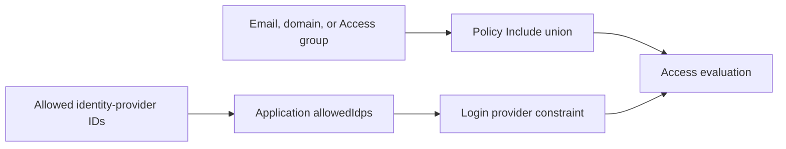

# Runbook: Protected admin IdP authorization integrity

Status: M1 confirmed by the user's standing instruction to continue autonomously with the SLO skills on defensive cybersecurity work.
Runbook ID: `protected-admin-idp-authorization`
Finding: `csf_18a737a03f908a5ae725cd34` — allowed identity providers are emitted as alternative authorization selectors.
Base: `f9b888596ba933f69f183a542e7ab4926287a546`.
Data classification: hostnames, email allowlists, Access group IDs, and identity-provider IDs are internal authorization configuration; no credential or user-session data is handled.

## 1. Metadata and provider contract

| Field                     | Value                                                                                                                                                                               |
| ------------------------- | ----------------------------------------------------------------------------------------------------------------------------------------------------------------------------------- |
| Project                   | Hulumi                                                                                                                                                                              |
| Primary stack             | TypeScript, Pulumi, Cloudflare Zero Trust Access                                                                                                                                    |
| Package                   | `@hulumi/cloudflare-baseline`                                                                                                                                                       |
| Prefix                    | `protected-admin-idp-authorization`                                                                                                                                                 |
| Focused test              | `pnpm --filter @hulumi/cloudflare-baseline test -- --run tests/protected-admin-hostname.test.ts`                                                                                    |
| Package gates             | test, build, typecheck, lint                                                                                                                                                        |
| Dependency/security audit | `python3 scripts/osv-dependency-gate.py --output <report>` plus Semgrep and secret-diff review                                                                                      |
| New dependencies          | none                                                                                                                                                                                |
| Public compatibility      | Existing inputs remain. Configurations that supplied only `allowedIdentityProviderIds` now fail closed and must add an email, email domain, or Access group authorization selector. |

Cloudflare documents that Include entries use OR logic: matching any entry makes a user eligible for access. The Login Methods selector checks only which identity provider authenticated the user. Application `allowed_idps` instead limits the providers users may select and is not an authorization allowlist. M1 keeps identity-provider IDs in `allowedIdps` and out of every policy Include array.

Provider references:

- [Cloudflare Access policy rule semantics](https://developers.cloudflare.com/reference-architecture/design-guides/designing-ztna-access-policies/)
- [Cloudflare Access policies and common misconfigurations](https://developers.cloudflare.com/cloudflare-one/access-controls/policies/)
- [Cloudflare Access application `allowed_idps`](https://developers.cloudflare.com/api/resources/zero_trust/subresources/access/subresources/applications/methods/create/)

## 2. Problem and architecture

The component currently copies every identity-provider ID into `loginMethod` entries in both its inline and reusable policy Include arrays. Because those entries are OR alternatives to an email, domain, or group selector, any user who authenticates through the provider can satisfy the allow policy. The same IDs are also set correctly as application `allowedIdps`, so the unsafe policy entries are redundant.

Authentication routing and authorization remain separate. An application may restrict login choices to selected providers, but one or more identity authorization selectors must independently define the eligible user set.

## 3. Security and outcome contracts

- **Value wedge:** configuring an approved provider must not authorize every user of that provider.
- **Threat class:** CWE-284 improper access control and CWE-863 incorrect authorization.
- **Abuse case:** `tm-hulumi-access-idp-or-bypass` — an attacker with any account at an allowed provider satisfies a `loginMethod` Include alternative despite not matching the declared email/domain/group allowlist.
- **Measurement:** no generated inline or reusable policy contains `loginMethod`; an IdP-only declaration rejects before any Cloudflare provider resource is registered.
- **Outcome:** the application carries `allowedIdps`, while policy Includes contain only the declared email, email-domain, and Access-group authorization union.

### Outcome validation

- `oc-protected-admin-idp-1`: Given only identity-provider IDs, when constructing the component, then it rejects before provider resources because no authorization allowlist exists.
- `oc-protected-admin-idp-2`: Given an email plus selected identity providers, when rendering both policy forms, then each Include array contains only the email and the application contains the provider IDs in `allowedIdps`.
- `oc-protected-admin-idp-3`: Given an Access group plus an identity provider, when rendering the component, then the group remains the authorization selector and the provider remains authentication routing.
- `cuj-protected-admin-idp-1`: declare authorized identities → optionally constrain provider choices → create protected application → evaluate identity allowlist.

## 4. M1 — separate provider selection from authorization

Status: local execution and verification complete; exact-head CI, merge, and merged-main scan pending.
Started: 2026-10-15
Refactor budget: the protected-admin component, focused tests, package/component documentation, and SLO evidence.

### Contract block

| Contract item       | M1 decision                                                                                                                      |
| ------------------- | -------------------------------------------------------------------------------------------------------------------------------- |
| Goal                | Prevent an allowed login provider from becoming an alternative grant of access.                                                  |
| Exemplar            | `allowedIdps` limits the application login picker while an email or Access group determines authorization.                       |
| Anti-exemplar       | `{ loginMethod: { id } }` beside an email or group in an OR-combined Include array.                                              |
| Data classification | Internal authorization metadata only; no token, cookie, identity assertion, or credential.                                       |
| Abuse acceptance    | IdP-only configuration rejects; mixed configuration emits no `loginMethod`; both policy forms remain aligned.                    |
| Resource bound      | No new resources or provider calls; existing selector counts and provider schema apply.                                          |
| Invariant           | Every policy Include member is an email, email domain, or Access group declared as an authorization selector.                    |
| Failure behavior    | Invalid or IdP-only configuration throws synchronously before registering Cloudflare provider resources.                         |
| Compatibility       | Input names remain. `requiredIdentitySelectors` reports authorization evidence only; IdP-only callers must add a real allowlist. |

### Allowed files

- `docs/RUNBOOK-protected-admin-idp-authorization.md`
- `docs/slo/critique/protected-admin-idp-authorization-m1.md`
- `docs/slo/verify/protected-admin-idp-authorization-m1.md`
- `docs/slo/lessons/protected-admin-idp-authorization-m1.md`
- `docs/slo/completion/protected-admin-idp-authorization-m1.md`
- `packages/cloudflare-baseline/src/protected-admin-hostname.ts`
- `packages/cloudflare-baseline/src/protected-admin-hostname.args.ts`
- `packages/cloudflare-baseline/tests/protected-admin-hostname.test.ts`
- `packages/cloudflare-baseline/README.md`
- `docs/components/protected-admin-hostname.md`

### BDD acceptance

| ID       | Given/when                                              | Then                                                                               |
| -------- | ------------------------------------------------------- | ---------------------------------------------------------------------------------- |
| BDD-M1-1 | only `allowedIdentityProviderIds` is supplied           | construction rejects before provider resources                                     |
| BDD-M1-2 | email and IdP IDs are supplied                          | application has `allowedIdps`; inline and reusable policies contain the email only |
| BDD-M1-3 | Access group and IdP ID are supplied                    | policies contain the group only and never `loginMethod`                            |
| BDD-M1-4 | existing email/domain/group configurations are supplied | their authorization union remains unchanged                                        |
| BDD-M1-5 | outputs settle                                          | `requiredIdentitySelectors` contains authorization selectors only                  |
| BDD-M1-6 | package and workspace regressions run                   | no dependency graph or unrelated behavior changes                                  |

### Evidence log

| Evidence        | Required result                                                                        |
| --------------- | -------------------------------------------------------------------------------------- |
| Repo hygiene    | branch starts from exact merged `origin/main`                                          |
| Baseline        | focused component tests and package gates pass before RED changes                      |
| RED             | new authorization-boundary BDDs fail only for the unsafe IdP policy entries            |
| Focused/package | complete component and package test/build/typecheck/lint pass                          |
| Dependency      | no manifest/lock diff; official OSV gate reports zero vulnerabilities and zero `MAL-*` |
| Static/security | Semgrep and secret diff report zero findings/errors                                    |
| GitHub          | signed+DCO exact-head CI green                                                         |
| Post-merge      | exact merged-main Codex Security scan completed; source finding absent                 |

### Local result

- Baseline: 3/3 focused tests plus package build, typecheck, and lint.
- RED: three intended failures and four passing controls against the old authorization behavior.
- GREEN: 7/7 focused tests; complete package suite 24 passed with three live-provider tests intentionally skipped.
- Full workspace test, build, typecheck, lint, format, license, exact-pin, and workflow-governance gates passed across 19 runnable projects.
- Official OSV-Scanner 2.7.0 scanned two unchanged lockfiles and 575 package occurrences with zero vulnerabilities and zero `MAL-*`.
- Semgrep 1.156.0 ran 74 rules over three changed TypeScript files with zero findings and zero errors.
- Secret review, exact allow-list, dependency diff, and diff hygiene passed.

### Forbidden shortcuts and out of scope

- No `loginMethod` authorization alternative, IdP-only implicit grant, broad Everyone/valid-email selector, hidden bypass, or claim that provider selection proves user membership.
- No new dependency, manifest, lockfile, version, publication, live Cloudflare call, identity-provider creation, MFA policy, device posture, or component-wide redesign.

### Definition of done

All BDD and outcome scenarios pass; both policy representations contain only real authorization selectors; no allow-list or dependency drift exists; the signed exact-head PR is green and merged under standing authorization; an exact merged-main Codex Security scan confirms the source finding is absent.
