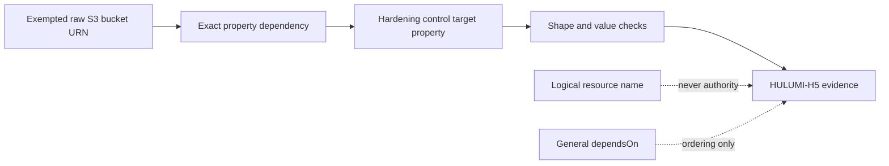

# Runbook: S3 hardening control-to-bucket binding

Status: M1 confirmed by the user's standing instruction to continue autonomously with the SLO skills on defensive cybersecurity work.
Runbook ID: `s3-hardening-bucket-binding`
Finding: `csf_2d48d1445109f7be71560655` — HULUMI-H5 mixes logical and physical names and can attribute another bucket's controls to an exempted bucket.
Base: `071232a246864316b5217fdfd24843e1eb0696fe`.
Data classification: Pulumi URNs, dependency edges, bucket identifiers, and policy documents are internal infrastructure metadata; no credentials or object data are handled.

## 1. Metadata and provider contract

| Field                     | Value                                                                                                                   |
| ------------------------- | ----------------------------------------------------------------------------------------------------------------------- |
| Project                   | Hulumi                                                                                                                  |
| Primary stack             | TypeScript, Pulumi CrossGuard, AWS S3                                                                                   |
| Package                   | `@hulumi/policies`                                                                                                      |
| Prefix                    | `s3-hardening-bucket-binding`                                                                                           |
| Focused test              | `pnpm --filter @hulumi/policies test -- --run tests/hulumi-hardening-pack.test.ts`                                      |
| Package gates             | test, build, typecheck, lint                                                                                            |
| Dependency/security audit | `python3 scripts/osv-dependency-gate.py --output <report>` plus Semgrep and secret-diff review                          |
| New dependencies          | none                                                                                                                    |
| Public compatibility      | HULUMI-H5 now requires real per-property dependency evidence; synthetic policy fixtures must model the real Pulumi DAG. |

Pulumi documents that a `PolicyResource` contains both general `dependencies` and the dependencies that affect each property in `propertyDependencies`. Pulumi also documents that passing a resource output as another resource's input creates a tracked dependency, while `dependsOn` is only a general ordering dependency. M1 treats the property edge as the authority for target binding; a general dependency or a coincidentally equal logical name is insufficient.

Provider references:

- [Pulumi Policy SDK `PolicyResource`](https://www.pulumi.com/docs/reference/pkg/python/pulumi_policy/)
- [Pulumi input/output dependency tracking](https://www.pulumi.com/docs/iac/concepts/inputs-outputs/)
- [Pulumi `dependsOn` semantics](https://www.pulumi.com/docs/iac/concepts/resources/options/dependson/)
- [Pulumi CrossGuard stack-policy timing](https://www.pulumi.com/docs/iac/using-pulumi/crossguard/core-concepts/)

## 2. Problem and architecture

HULUMI-H5 currently builds a set containing a bucket's logical `PolicyResource.name`, `props.bucket`, and `props.id`, then accepts any same-type-chain sibling whose `bucket` property equals any member. Parent component instance names are not represented by the current type-chain comparison. An attacker can therefore give one unprotected bucket a logical name that equals another bucket's physical name and reuse the second bucket's hardening resources as evidence.

The fixed rule correlates each control with the exact bucket URN through the property that targets the bucket. Public-access block, encryption, ownership, and versioning require `propertyDependencies.bucket`. A bucket policy requires the same exact edge for `bucket` and for `policy`, because the latter embeds the bucket ARN. Existing control-shape and TLS resource coverage checks remain mandatory.

## 3. Security and outcome contracts

- **Value wedge:** hardening evidence for one S3 bucket must never authorize an H1 exemption for another bucket.
- **Threat class:** CWE-706 use of incorrectly resolved name or reference.
- **Abuse case:** `tm-hulumi-h5-cross-bucket-binding` — an untrusted Pulumi author crosses a victim logical name with a hardened bucket's physical name so all five controls appear to match.
- **Measurement:** every accepted control has an exact property dependency on the exempted bucket URN; logical-name candidates and general dependencies do not satisfy HULUMI-H5.
- **Outcome:** a bucket passes only when all five hardened controls are structurally valid and their target-bearing properties derive from that exact bucket resource.

### Outcome validation

- `oc-s3-binding-1`: Given two SecureBucket-shaped component instances with crossed logical/physical identifiers, when HULUMI-H5 evaluates the unprotected bucket, then the other bucket's controls do not satisfy it.
- `oc-s3-binding-2`: Given shape-correct controls with equal string values but no property edge, when HULUMI-H5 evaluates them, then it reports every missing control.
- `oc-s3-binding-3`: Given controls with only a general `dependsOn` edge, when HULUMI-H5 evaluates them, then it fails closed.
- `oc-s3-binding-4`: Given a genuine SecureBucket graph, when every target-bearing property depends on the exact bucket, then HULUMI-H5 accepts it.
- `cuj-s3-binding-1`: declare SecureBucket → propagate bucket outputs into control inputs → preview with policy pack → verify exact binding and control shape.

## 4. M1 — bind hardening evidence to exact bucket dependencies

Status: local execution and verification complete; exact-head CI, merge, and merged-main scan pending.
Started: 2026-10-15
Refactor budget: HULUMI-H5 helpers, focused policy tests, package/component documentation, and SLO evidence.

### Contract block

| Contract item       | M1 decision                                                                                                                                   |
| ------------------- | --------------------------------------------------------------------------------------------------------------------------------------------- |
| Goal                | Prevent one bucket's hardening controls from satisfying another bucket's exemption.                                                           |
| Exemplar            | `control.propertyDependencies.bucket` contains the exact exempted bucket resource; policy also binds `policy` to that bucket.                 |
| Anti-exemplar       | A control's `bucket` string equals the victim logical name, or a general `dependsOn` edge mentions the victim.                                |
| Data classification | Internal resource graph and policy metadata only.                                                                                             |
| Abuse acceptance    | Crossed names, equal strings without property edges, a second component's controls, and general-only dependencies all fail closed.            |
| Resource bound      | Linear scan of existing stack resources and bounded dependency arrays; no provider or network operation.                                      |
| Invariant           | Each accepted control property is causally derived from the exact bucket URN it is used to harden.                                            |
| Failure behavior    | Missing or ambiguous property binding contributes that control to the HULUMI-H5 violation; the rule does not guess from names.                |
| Compatibility       | Genuine SecureBucket programs already pass bucket outputs into all target-bearing properties; policy tests must represent those actual edges. |

### Allowed files

- `docs/RUNBOOK-s3-hardening-bucket-binding.md`
- `docs/slo/critique/s3-hardening-bucket-binding-m1.md`
- `docs/slo/verify/s3-hardening-bucket-binding-m1.md`
- `docs/slo/lessons/s3-hardening-bucket-binding-m1.md`
- `docs/slo/completion/s3-hardening-bucket-binding-m1.md`
- `packages/policies/src/aws/hulumi-hardening-pack.ts`
- `packages/policies/tests/hulumi-hardening-pack.test.ts`
- `packages/policies/README.md`
- `docs/components/secure-bucket.md`

### BDD acceptance

| ID       | Given/when                                                                 | Then                                                                                    |
| -------- | -------------------------------------------------------------------------- | --------------------------------------------------------------------------------------- |
| BDD-M1-1 | two bucket instances cross a logical name and another physical identifier  | the hardened instance's controls cannot satisfy the unprotected bucket                  |
| BDD-M1-2 | target strings match but `propertyDependencies.bucket` is absent           | PAB, SSE, ownership, versioning, and policy evidence are rejected                       |
| BDD-M1-3 | controls list the bucket only in general `dependencies`                    | general ordering edges do not count as target evidence                                  |
| BDD-M1-4 | a policy's `bucket` edge is correct but its `policy` edge is absent        | the TLS-only policy is rejected because its ARN document is not bound                   |
| BDD-M1-5 | every genuine control property depends on the exact bucket and shapes pass | no HULUMI-H5 violation is reported                                                      |
| BDD-M1-6 | package and workspace regressions run                                      | H1-H4 and unrelated policy behavior remain unchanged; no dependency graph change occurs |

### Evidence log

| Evidence        | Required result                                                                        |
| --------------- | -------------------------------------------------------------------------------------- |
| Repo hygiene    | branch starts from exact merged `origin/main`                                          |
| Baseline        | focused policy tests and package gates pass before RED changes                         |
| RED             | crossed-name and dependency-edge BDDs fail only for the unsafe attribution behavior    |
| Focused/package | complete policy package test/build/typecheck/lint pass                                 |
| Dependency      | no manifest/lock diff; official OSV gate reports zero vulnerabilities and zero `MAL-*` |
| Static/security | Semgrep and secret diff report zero findings/errors                                    |
| GitHub          | signed+DCO exact-head CI green                                                         |
| Post-merge      | exact merged-main Codex Security scan completed; source finding absent                 |

### Local result

- Baseline: 52/52 focused tests plus package build, typecheck, and lint.
- RED: seven intended failures with 52 passing controls against crossed identities, four missing target-property edges, a policy-document edge omission, and general-only dependencies.
- GREEN: 61/61 focused tests; complete policy package 395/395 tests across 18 files.
- Full workspace build, test, typecheck, lint, format, license-boundary, exact-pin, and workflow-governance gates passed across 19 runnable projects.
- Official OSV-Scanner 2.7.0 scanned two unchanged lockfiles and 575 package occurrences with zero vulnerabilities and zero `MAL-*`.
- Semgrep 1.156.0 ran 110 effective rules (74 TypeScript and 36 multilang) over the two changed TypeScript files with zero findings and zero errors.
- Secret review, exact allow-list, dependency diff, and diff hygiene passed.

### Forbidden shortcuts and out of scope

- No logical-name fallback, any-candidate set, general-dependency fallback, type-chain-only attribution, suppression broadening, or shape-check weakening.
- No new dependency, manifest, lockfile, version, publication, live AWS call, H1-H4 semantic change, or package-wide refactor.

### Definition of done

All BDD and outcome scenarios pass; each accepted control has the required exact property edges and still satisfies its hardening shape; no scope or dependency drift exists; the signed exact-head PR is green and merged under standing authorization; an exact merged-main Codex Security scan confirms the source finding is absent.
