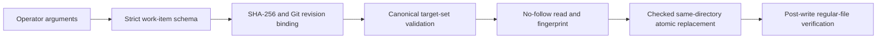

# Runbook — SCA remediation path integrity

**Runbook ID:** `sca-remediation-path-integrity`
**Prefix:** `sca-remediation-path-integrity`
**Status:** in progress
**Target:** `kerberosmansour/hulumi`
**Finding:** `csf_896f7e0dca6da265597eac34` / CWE-22
**Base revision:** `117c612be7b58be343e85970ce93b3598ac6a229`

## 1. Problem and outcome

`remediateFromFiles` treats an untrusted work-item file as both identity and authorization. A
crafted absolute, traversal, or symlinked `manifestPaths` value can therefore reach a file writer
outside the reviewed repository when `--apply true` is used.

The outcome is a bounded apply boundary: only a strictly validated work item whose exact SHA-256
and repository commit were supplied by the operator may modify canonical regular files beneath the
explicit repository root. Every direct and derived target is checked before mutation, and writes
use same-directory atomic replacement with no-follow opens and concurrent-change detection.

## 2. Stable interfaces and red lines

- Read-only planning remains available without apply authorization.
- Apply requires `--repository-root`, `--expected-revision`, and `--work-items-sha256`.
- Paths use canonical repository-relative POSIX spelling. Absolute paths, backslashes, empty or
  dot segments, traversal, symbolic links, missing targets, and non-regular files fail closed.
- The reviewed work-item digest and checked-out Git commit must match before agent review or writes.
- Direct and derived mutation targets are computed by trusted code and validated as one set.
- No dependency resolution, lifecycle execution, installation, version, lockfile, or publication
  change is in scope. The existing pnpm apply path is refused because it cannot satisfy this bounded
  file-mutation contract.
- No live provider or external repository mutation is permitted.

## 3. Architecture

## 4. Milestone tracker

| Milestone | Title                                                    | Status           | Completed  | Evidence                                               |
| --------- | -------------------------------------------------------- | ---------------- | ---------- | ------------------------------------------------------ |
| M1        | Bind remediation apply to a reviewed repository revision | locally verified | 2026-10-15 | `docs/slo/verify/sca-remediation-path-integrity-m1.md` |

## 5. Formal verification

TLA+ and Kani are not required. The boundary is a Node.js filesystem/CLI contract whose relevant
properties are exercised through real temporary directories, Git repositories, links, FIFOs, and
concurrent file replacement.

## 5A. Measurement contract

- **Leading:** every hostile-path and stale-binding BDD case rejects before the external target or
  in-repository manifest changes.
- **Lagging:** an authorized apply changes exactly the derived target set and no other file.
- **Guardrail:** zero dependency/lockfile diff in this milestone; owner is the repository maintainer.
- **Readout:** milestone verification and exact-main Codex Security scan.

## 5B. Secure value and security contract

- **Value wedge:** operators can review one immutable remediation input and one immutable checkout,
  then know the apply step cannot escape that boundary.
- **Operator readiness:** the CLI documents how to compute the work-item SHA-256 and exact Git commit;
  missing or malformed bindings stop the run.
- **Threat summary:** a malicious checkout or supplied work-item file attempts traversal, absolute
  paths, links, special files, stale revisions, digest substitution, or a target swap during apply.
- **Security tests:** Bundle A strict-schema validation; B boundary and link attacks; C digest/revision
  tamper; D concurrent target replacement; E positive exact-file mutation; F OSV/Semgrep/full CI.
- **Detected work ledger:** `csf_896f7e0dca6da265597eac34` = `fix_now`. Lifecycle-safe dependency
  resolution is a separate existing finding and remains outside this milestone.
- **Proactive controls:** OWASP Proactive Controls C3 Validate All Input and Handle Exceptions, and C4
  Address Security from the Start. CWE-22 is eliminated at the apply boundary.

## 5C. Outcome validation contract

- CLI layer: applicable — real argument parsing supplies all three apply bindings.
- Repository layer: applicable — a real temporary Git repository supplies the exact HEAD and files.
- Filesystem layer: applicable — real regular files, links, a FIFO, and outside sentinels are used.
- External provider layer: not applicable — the milestone performs no network or provider operation.
- Cross-layer assertion: CLI authorization plus Git binding plus filesystem validation permits one
  ordinary manifest update and preserves the outside sentinel byte-for-byte.

## 6. M1 contract — Bind remediation apply to a reviewed repository revision

### Goal

Eliminate untrusted path authority in file-based emergency remediation without introducing any new
dependency or executing a package manager.

### Files allowed to change

1. `docs/RUNBOOK-sca-remediation-path-integrity.md`
2. `docs/slo/critique/sca-remediation-path-integrity-m1.md`
3. `docs/slo/verify/sca-remediation-path-integrity-m1.md`
4. `docs/slo/lessons/sca-remediation-path-integrity-m1.md`
5. `docs/slo/completion/sca-remediation-path-integrity-m1.md`
6. `tools/sca/src/cli/remediate.ts`
7. `tools/sca/test/security-boundaries.test.ts`
8. `tools/sca/README.md`

### Files to read first

- `tools/sca/src/cli/remediate.ts`
- `tools/sca/src/cli/triage.ts`
- `tools/sca/src/evidence/normalize.ts`
- `tools/sca/src/state/store.ts`
- `tools/sca/test/security-boundaries.test.ts`
- `SECURITY.md`

### Contract block

| Field               | Contract                                                                                                                               |
| ------------------- | -------------------------------------------------------------------------------------------------------------------------------------- |
| Public surface      | `sca remediate-emergency` apply authorization flags                                                                                    |
| Compatibility       | Read-only planning stays compatible; apply intentionally fails closed until the new bindings are supplied                              |
| Error semantics     | One bounded error, no write, no agent review, no package-manager execution                                                             |
| Exemplar            | Scanner cache path-component checks in `tools/sca/src/cli/scan.ts`                                                                     |
| Anti-exemplar       | `allowedPathsFor` and raw `readFile`/`writeFile` on evidence paths in the pre-fix remediation code                                     |
| AI tolerance        | N/A — the changed authorization boundary is deterministic; the reviewer backend is not trusted to authorize paths                      |
| Data classification | Internal; paths and dependency metadata may reveal repository layout                                                                   |
| Proactive controls  | strict schema, immutable digest/revision binding, canonicalization, no-follow handles, atomic replacement, postconditions              |
| Abuse cases         | absolute escape; `../` escape; backslash ambiguity; final/intermediate symlink; FIFO; stale HEAD; wrong digest; concurrent target swap |
| Refactor budget     | No refactor beyond the direct authorization and safe-file helpers                                                                      |

### BDD acceptance

| ID  | Given                                                | When                                     | Then                                                           |
| --- | ---------------------------------------------------- | ---------------------------------------- | -------------------------------------------------------------- |
| B1  | a valid emergency item and exact bindings            | apply runs in a temporary Git repository | only the expected manifest changes                             |
| B2  | an absolute or traversal manifest path               | apply is requested                       | it rejects before touching the outside sentinel                |
| B3  | a path with a backslash or non-canonical segment     | apply is requested                       | it rejects before review or mutation                           |
| B4  | an intermediate or final symbolic link               | apply is requested                       | it rejects the linked component                                |
| B5  | a FIFO or directory target                           | apply is requested                       | it rejects the non-regular target without opening it for data  |
| B6  | the checkout HEAD differs from `--expected-revision` | apply is requested                       | it rejects before review or mutation                           |
| B7  | work-item bytes differ from `--work-items-sha256`    | apply is requested                       | it rejects before review or mutation                           |
| B8  | the target changes after the checked read            | atomic replacement begins                | it rejects the concurrent change and preserves the replacement |
| B9  | duplicate evidence or inconsistent finding identity  | planning begins                          | strict validation rejects the input                            |
| B10 | a pnpm workspace item                                | apply is requested                       | it fails closed without invoking pnpm                          |

### Outcome scenario

`oc-sca-remediation-path-integrity-1`: An operator applies a reviewed package-lock remediation at an
exact Git revision; the intended lockfile/package manifest pair changes, every outside sentinel and
unlisted file remains unchanged, and a repeated run against stale bindings rejects.

### Critical user journey

`cuj-sca-remediation-path-integrity-1`: hash work item → record HEAD → invoke apply with explicit root
and bindings → observe exact-file result → rerun with stale binding and observe fail-closed behavior.

### Core capability regression matrix

| Capability                                    | Required result |
| --------------------------------------------- | --------------- |
| Read-only emergency plan                      | pass            |
| Agent tool restrictions                       | pass            |
| Malicious-package fail-closed behavior        | pass            |
| Scanner integrity tests                       | pass            |
| No package-manager execution in bounded apply | pass            |

### Forbidden shortcuts

- Do not trust `manifestPaths` as an allow-list.
- Do not use prefix-only path checks.
- Do not follow links or special files.
- Do not use ordinary path-based overwrite after a separate validation pass.
- Do not treat an operator confirmation flag as revision or input provenance.
- Do not run pnpm/npm/pip/dotnet as part of this milestone.

### Evidence log

| Gate                      | Expected                                      | Actual result                                                                                          |
| ------------------------- | --------------------------------------------- | ------------------------------------------------------------------------------------------------------ |
| Baseline SCA tests        | 26 passing                                    | 26 passing after script-disabled install of the unchanged, OSV-clean lock                              |
| RED BDD                   | B2–B10 expose pre-fix behavior                | 27 controls passed and 8 intended regressions failed                                                   |
| GREEN BDD                 | B1–B10 pass                                   | 38/38 tests passed, including npm, PyPI, and NuGet positive paths                                      |
| SCA build/lint            | pass                                          | strict TypeScript build, ESLint, and package formatting passed                                         |
| Full workspace            | pass                                          | all 19 runnable projects passed build, typecheck, sequential tests, lint, and formatting               |
| OSV                       | zero vulnerabilities and MAL advisories       | OSV-Scanner 2.7.0 scanned 2 lockfiles / 575 package occurrences; zero vulnerability or `MAL-*` results |
| Semgrep                   | zero new findings/errors                      | Semgrep 1.156.0 ran 210 rules over 2 TypeScript targets; zero findings/errors                          |
| Scope and dependency diff | exact 8 paths, zero manifest/lockfile changes | exact 8-path allow-list; zero dependency manifest or lockfile changes                                  |
| Exact-head CI             | all applicable checks pass                    | pending                                                                                                |
| Exact-main Codex Security | no source or equivalent path escape           | pending                                                                                                |

### Definition of done

- B1–B10 and the outcome scenario pass against real temporary filesystem objects.
- All apply targets are derived, canonical, regular, repository-contained, and immutable-bound.
- Writes are checked and atomic; concurrent replacement is rejected.
- Operator documentation describes the required bindings and fail-closed limitations.
- Package, workspace, OSV, Semgrep, exact-head CI, and merged-main scan gates pass.
