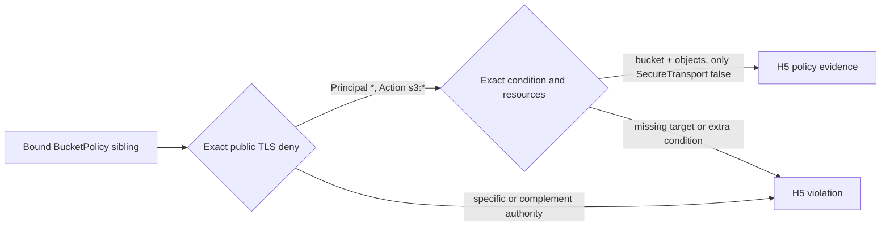

# Runbook — SecureBucket TLS policy binding

**Runbook ID:** `secure-bucket-tls-policy-binding`
**Prefix:** `secure-bucket-tls-policy-binding`
**Status:** locally verified; external closeout pending
**Target:** `kerberosmansour/hulumi`
**Finding:** `csf_b38a094764d7b6788e69edab` / CWE-693
**Base revision:** `8b967993deafd3c711c5031ad105255035603698`

## 1. Problem and outcome

The mandatory HULUMI-H5 stack policy binds a bucket policy to the exact exempted
bucket and requires `Deny` plus `aws:SecureTransport=false`, but it does not
verify that the statement applies to every principal and every S3 action. A
caller can add `NotPrincipal`, `NotAction`, `NotResource`, a specific principal
or action, or another condition that narrows the deny while retaining the fields
H5 currently recognizes.

The outcome is an exact statement contract for the H1 exemption: the accepted
TLS statement denies insecure transport to the public principal for `s3:*` on
the exact bucket and object ARNs, with no complement operator or additional
condition. Existing bucket identity, parent ancestry, dependency-edge, sibling,
suppression, and H1–H4 behavior remain stable.

## 2. Stable interfaces and red lines

- Preserve public rule ID `HULUMI-H5`, exported symbols, and the existing
  mandatory enforcement level.
- Accept `Principal: "*"`, `Action: "s3:*"` or the singleton equivalent
  `Action: ["s3:*"]`, the exact bucket/object resources, and exactly one
  `Bool` condition setting `aws:SecureTransport` to `"false"` or `false`.
- Reject `NotPrincipal`, `NotAction`, `NotResource`, a specific principal or
  action, missing target ARNs, unknown statement keys, and any extra condition.
- Do not change H1–H4, the suppression API, bucket identity resolution,
  sibling ancestry, dependency-edge proof, or any emitted AWS resource.

## 3. Architecture

## 4. Milestone tracker

| Milestone | Title                              | Status           | Completed | Evidence                                                 |
| --------- | ---------------------------------- | ---------------- | --------- | -------------------------------------------------------- |
| M1        | Bind the complete TLS deny meaning | locally verified | —         | `docs/slo/verify/secure-bucket-tls-policy-binding-m1.md` |

## 5. Formal verification

TLA+ and Kani are not required. This is deterministic TypeScript policy parsing
with a finite statement-shape partition exercised through the production
Pulumi stack-validation function.

## 5A. Measurement contract

- **Leading:** every narrowed or complemented statement produces the existing
  H5 missing-TLS-policy violation.
- **Lagging:** the exact merged-main Codex Security scan no longer reports the
  finding or an equivalent H5 TLS-deny bypass.
- **Guardrail:** the 61-test focused baseline, genuine SecureBucket fixture,
  suppression behavior, and all non-policy sibling controls remain green.
- **Readout:** focused/package/workspace tests, OSV, Semgrep, exact-head CI, and
  exact-main scan.

## 5B. Security contract

- **Threat:** an IaC author forges the SecureBucket type chain and supplies
  hardening-shaped siblings whose bucket policy denies insecure transport only
  for a harmless subset, causing H5 to accept an ineffective control.
- **Invariant:** H5 accepts policy evidence only when the complete recognized
  statement is an unconditional public `s3:*` deny gated solely by insecure
  transport and bound to the exact bucket plus all its objects.
- **Failure behavior:** ambiguous, complemented, malformed, unknown, or narrowed
  statement shapes fail closed.
- **Detected-work ledger:** `csf_b38a094764d7b6788e69edab` = `fix_now`; no
  matching open GitHub issue was found on 2026-10-15.

## 5C. Outcome validation contract

- Principal/action layer: recognize only the bounded public and full-S3 shapes.
- Resource layer: retain exact physical bucket identity and bucket/object ARN
  requirements; reject complement targeting.
- Condition layer: accept only `Bool.aws:SecureTransport=false` with no sibling
  operator or key.
- External layer: not applicable; no AWS or Pulumi deployment call occurs.

## 6. M1 contract — Bind the complete TLS deny meaning

### Files allowed to change

1. `docs/RUNBOOK-secure-bucket-tls-policy-binding.md`
2. `docs/slo/critique/secure-bucket-tls-policy-binding-m1.md`
3. `docs/slo/verify/secure-bucket-tls-policy-binding-m1.md`
4. `docs/slo/lessons/secure-bucket-tls-policy-binding-m1.md`
5. `docs/slo/completion/secure-bucket-tls-policy-binding-m1.md`
6. `packages/policies/src/aws/hulumi-hardening-pack.ts`
7. `packages/policies/tests/hulumi-hardening-pack.test.ts`
8. `docs/components/secure-bucket.md`
9. `CHANGELOG.md`

### Contract block

| Field               | Contract                                                                                         |
| ------------------- | ------------------------------------------------------------------------------------------------ |
| Public surface      | Mandatory HULUMI-H5 preview behavior; public IDs and exports retained                            |
| Compatibility       | Genuine emitted TLS deny and singleton `s3:*` action array pass; narrowed statements now fail    |
| Error semantics     | Existing single H5 violation per exempted bucket; no policy document copied into diagnostics     |
| Exemplar            | `Deny`, `Principal:"*"`, `Action:"s3:*"`, both exact ARNs, sole SecureTransport-false condition  |
| Anti-exemplar       | Treating field presence as proof while complement or additional condition narrows the deny       |
| Data classification | Internal bucket identity and IAM policy metadata; policy contents remain absent from diagnostics |
| Abuse cases         | NotPrincipal/NotAction/NotResource; specific principal/action; extra condition; unknown key      |
| Refactor budget     | One local exact-statement predicate, focused tests, component documentation, changelog           |

### BDD acceptance

| ID  | Given                                                           | When H5 evaluates it   | Then                                                   |
| --- | --------------------------------------------------------------- | ---------------------- | ------------------------------------------------------ |
| B1  | the genuine SecureBucket TLS statement                          | stack validation runs  | no H5 violation is reported                            |
| B2  | the action is the singleton array `["s3:*"]`                    | stack validation runs  | no H5 violation is reported                            |
| B3  | Principal is specific or `NotPrincipal` is present              | stack validation runs  | the TLS policy evidence is rejected                    |
| B4  | Action is specific or `NotAction` is present                    | stack validation runs  | the TLS policy evidence is rejected                    |
| B5  | `NotResource` is present or an exact target ARN is absent       | stack validation runs  | the TLS policy evidence is rejected                    |
| B6  | an extra condition/operator/value narrows SecureTransport=false | stack validation runs  | the TLS policy evidence is rejected                    |
| B7  | an unknown statement key or malformed document is supplied      | stack validation runs  | evaluation fails closed without copying policy content |
| B8  | package/workspace/security gates run                            | verification completes | all regressions pass with no dependency graph change   |

### Outcome scenario

`oc-secure-bucket-tls-policy-binding-1`: a forged SecureBucket wrapper supplies
a Deny statement that retains SecureTransport=false but exempts the attacker or
limits actions; preview continues to fail until the statement exactly matches
the public all-S3 TLS deny contract.

### Critical user journey

`cuj-secure-bucket-tls-policy-binding-1`: author SecureBucket-compatible stack →
preview → reject narrowed TLS policy → use the documented canonical statement →
preview passes only when all sibling controls remain bound to the exact bucket.

### Evidence log

| Gate                          | Expected                                      | Actual result                                                                                                                                |
| ----------------------------- | --------------------------------------------- | -------------------------------------------------------------------------------------------------------------------------------------------- |
| Baseline focused              | 61 passing                                    | 61 passing at exact merged main                                                                                                              |
| RED BDD                       | B3–B7 fail before implementation              | 8 intended failures; 63 positive controls passed                                                                                             |
| GREEN BDD                     | B1–B8 pass                                    | 71/71 focused; 495/495 policy-package tests                                                                                                  |
| Policies build/typecheck/lint | pass                                          | passed                                                                                                                                       |
| Full workspace                | pass                                          | 19 runnable projects; build/typecheck/lint passed; 1,354 tests passed                                                                        |
| OSV                           | zero vulnerability and `MAL-*` results        | OSV 2.7.0; 2 lockfiles / 575 package occurrences / zero findings; SHA-256 `10c55dbf5e83d5268eb5fa37e826477ae5eb4a972a2fe38e0a6832f28be95df4` |
| Semgrep                       | zero findings/errors                          | 210 rules / 2 TypeScript targets / zero findings or errors; SHA-256 `8edf446fe2d48bceb214caeb4aee3582198ab66d0fe82651da5c91fab2d40dae`       |
| Scope and dependency diff     | exact 9 paths; zero manifest/lockfile changes | passed locally; final staged check remains                                                                                                   |
| Exact-head CI                 | all applicable checks pass                    | pending                                                                                                                                      |
| Exact-main Codex Security     | finding and equivalents absent                | pending                                                                                                                                      |

### Definition of done

- B1–B8 and all existing H1–H5 regressions pass.
- The complete statement meaning is verified, not individual field presence.
- Documentation states the exact accepted shape and residual boundary.
- Package/workspace, OSV, Semgrep, exact-head CI, and merged-main scan gates pass.
