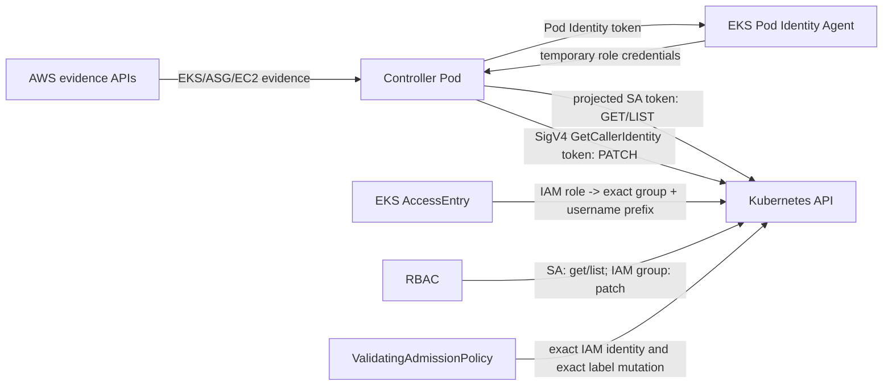

# Runbook: EKS trusted-node label patch authority M4b

Status: implementation and local verification complete; external ship gates pending
Owner: repository maintainers
Base revision: `e114dc29bad8f299a3614a4260a9ab1fcb0a27c3`
Issue: `kerberosmansour/hulumi#305`
Confirmation basis: the user authorized autonomous defensive execution and publication on 2026-10-16.

## Problem and target invariant

The reconciler currently authenticates every Kubernetes request with one projected
ServiceAccount bearer token. The same ServiceAccount has cluster-wide Node
`get`, `list` and `patch`, and admission authorizes protected-label mutation by
matching its reusable username. Theft of that bearer token is therefore enough
to exercise the exact trusted-label add/remove path outside the controller.

M4b removes `patch` from the ServiceAccount identity. Reads continue to use its
short-lived projected token. Each PATCH must use a fresh EKS IAM authenticator
token signed with the component's Pod Identity credentials. A STANDARD EKS
AccessEntry maps that one IAM role to one component-specific Kubernetes group,
and RBAC plus admission require that group and the component-specific IAM
username prefix. The exact patch-shape, compare-and-swap and no-piggyback controls
from M4a remain unchanged.

The security invariant is: possession of the projected ServiceAccount token
alone never authorizes a Node PATCH. A patch requires both the admitted Pod
Identity credential path and the existing exact-mutation proof.

## Metadata and stable interfaces

| Field                         | Contract                                                                                                        |
| ----------------------------- | --------------------------------------------------------------------------------------------------------------- |
| Runbook ID                    | `eks-trusted-node-label-patch-authority-m4b`                                                                    |
| Prefix                        | `eks-trusted-node-label`                                                                                        |
| Stack                         | TypeScript, Pulumi AWS/Kubernetes, EKS Pod Identity, EKS AccessEntry, Kubernetes RBAC/CEL                       |
| Milestones                    | One: M4b patch-authority split                                                                                  |
| Public interfaces kept stable | `EksTrustedNodeLabelReconcilerArgs`, component token, outputs, runtime entry point, protected-label patch shape |
| Data classification           | Internal; temporary AWS credentials and Kubernetes bearer tokens are Restricted and must never be emitted       |
| Refactor budget               | No refactor beyond the authority split and its direct tests/docs                                                |
| AI tolerance contract         | N/A — no AI component                                                                                           |

## Milestone tracker

| Milestone                 | State         | Started    | Completed | Exit condition                                                                                     |
| ------------------------- | ------------- | ---------- | --------- | -------------------------------------------------------------------------------------------------- |
| M4b patch-authority split | `in_progress` | 2026-10-16 |           | Exact authority split, dependency admission, local/CI/security evidence and merged-main proof pass |

## End-state architecture

| Flow                         | Bound                                                                                    | Failure behavior                                              |
| ---------------------------- | ---------------------------------------------------------------------------------------- | ------------------------------------------------------------- |
| Projected token read         | 16 KiB token, 10 s request timeout, existing finite paging                               | Fail closed; no plan or mutation                              |
| Pod Identity credential read | exact injected URI/token-file contract, 1 s timeout, zero retries per credential attempt | Stable authorization error; no PATCH                          |
| EKS IAM token                | 60-second presign parameter, 4 KiB token maximum, fresh token per PATCH                  | Reject before network mutation                                |
| Node PATCH                   | Existing 4/5 operation exact JSON Patch                                                  | Kubernetes tests/admission reject stale or piggybacked writes |

## State and verification model

No new distributed state is persisted. Formal TLA+/Kani work is not required for
this milestone: authorization is checked with render-time contracts, deterministic
SigV4 vectors and an adapter-to-TLS cross-layer test. The existing M1 TLA+ stale
plan model remains applicable to the mutation itself.

| State                                             | Allowed action            | Safety rule                               |
| ------------------------------------------------- | ------------------------- | ----------------------------------------- |
| Valid projected SA token only                     | GET/LIST                  | PATCH RBAC and admission deny             |
| Valid IAM role token without exact group/username | API discovery only        | PATCH denied                              |
| Exact IAM identity plus malformed/stale patch     | None                      | Admission/JSON Patch deny                 |
| Exact IAM identity plus current exact patch       | PATCH one protected label | Existing CAS and no-piggyback rules apply |

Invalid states made unrepresentable: the Kubernetes adapter accepts separate
read-token and patch-token providers; PATCH cannot fall back to the read token,
and production IAM credential loading accepts only the EKS Pod Identity injected
endpoint/token-file contract.

## Secure Value & Security Contract

- **Value wedge:** remove bearer-token-only Node mutation authority without
  broadening the controller's cloud or Kubernetes permissions.
- **Operator readiness:** the target cluster must use authentication mode `API`
  or `API_AND_CONFIG_MAP`, run the EKS Pod Identity Agent, support
  `admissionregistration.k8s.io/v1`, and deploy the matching controller image.
  `CONFIG_MAP`-only clusters fail when the AccessEntry is created; no `aws-auth`
  fallback is permitted.
- **Threat-model summary:** update
  `docs/slo/design/eks-trusted-node-label-reconciler-threat-model.md` so abuse
  case 6 distinguishes stolen ServiceAccount tokens from a Pod admitted with the
  same ServiceAccount. The former class is eliminated; the latter is residual at
  the namespace workload-admission boundary.
- **Security tests:** Bundle A exact inputs and environment; B two independent
  authentication paths and least privilege; C stale/changed token and patch
  state; D OSV/MAL, provenance, integrity and graph diff; E redaction; F real
  TLS adapter path plus deterministic SigV4 token structure.
- **Detected work ledger:** findings must end as `fix_now`,
  `file_github_issue`, `operator_action`, `upstream_feedback` or
  `accepted_risk`. No silent deferral or blanket waiver.
- **OWASP Proactive Controls 2024:** C1 Implement Access Control, C3 Validate All
  Input and Handle Exceptions, C9 Implement Security Logging and Monitoring,
  C10 Stop Failures from Escalating.

### Secure-construction surface map

| Surface                   | Default applied                                                                                                                                                                             |
| ------------------------- | ------------------------------------------------------------------------------------------------------------------------------------------------------------------------------------------- |
| Kubernetes authorization  | Split read and mutation identities; bind mutation to the exact IAM username prefix and exact component group; preserve exact patch-shape admission.                                         |
| Restricted credentials    | Read only the exact EKS Pod Identity URI and token-file contract with finite bounds; reject ambient/default-chain, IMDS, profile, web-identity and static credential fallbacks.             |
| SigV4 authentication      | Use the admitted AWS signer with Node crypto for the standard EKS GetCallerIdentity token; sign the exact cluster ID and regional endpoint; generate once per PATCH and never log/cache it. |
| Pulumi/AWS/Kubernetes IaC | Exact role trust tags, one STANDARD AccessEntry, minimal independent ClusterRoles, fail-closed admission and Pulumi mock assertions.                                                        |
| Failure and observability | Stable redacted error codes, no bearer or temporary-credential material, no PATCH on any credential/token/transport validation failure.                                                     |

Measurement contract: N/A — this is a security correction to an existing
capability, not a new value-bearing feature. Outcome Validation Contract: N/A by
the same classification; the security outcome is still exercised by the BDD and
cross-layer runtime scenarios below.

### Detected work ledger

| Finding                                                                                                             | Disposition       | Owner / expiry                                                     | Evidence                                                                                                                                     |
| ------------------------------------------------------------------------------------------------------------------- | ----------------- | ------------------------------------------------------------------ | -------------------------------------------------------------------------------------------------------------------------------------------- |
| The projected ServiceAccount token could both read and patch Nodes.                                                 | `fix_now`         | M4b                                                                | Split read and mutation identities; focused Pulumi and TLS-path tests prove the old token is absent from PATCH.                              |
| Two already-transitive signer/HTTP provider packages become direct runtime imports.                                 | `fix_now`         | M4b                                                                | Script-disabled resolution, exact pins/integrities, complete graph/provenance/lifecycle review and OSV 2.7.0 report passed before execution. |
| A principal authorized to admit a Pod under the exact ServiceAccount can receive the same Pod Identity credentials. | `accepted_risk`   | Repository operator; expires before M3 live qualification sign-off | Explicit threat-model/operator boundary; namespace workload admission and governance are required.                                           |
| AccessEntry propagation can temporarily deny early PATCH attempts.                                                  | `accepted_risk`   | Repository maintainer; expires at M3 rolling qualification         | Failure is closed and later cycles re-attest and sign a fresh token; rollout guide states the availability window.                           |
| An old controller image paired with new RBAC cannot patch.                                                          | `operator_action` | M3 deployment operator                                             | Publish and deploy a digest-pinned image built from the matching source revision; roll back image and component together.                    |

## Dependency admission contract

Two direct imports are promoted from the already locked graph:
`@aws-sdk/credential-provider-http@3.972.76` and
`@smithy/signature-v4@5.7.4`. Candidate resolution must use
`pnpm install --lockfile-only --ignore-scripts`. Before any install, build, test,
or module execution against the candidate graph:

1. run the repository's official pinned `scripts/osv-dependency-gate.py` over
   every lockfile and save the JSON report;
2. review the complete importer/package graph diff, package integrities,
   publishers/source repositories, release age and all lifecycle scripts;
3. require zero `MAL-*` and no unowned known advisory;
4. add both promoted packages to the protected exact-pin registry;
5. fail closed on scanner, network or parsing error.

OSV is known-advisory evidence, not proof that unknown malware is absent.

## Exact file allow-list

Only these files may change:

- `docs/slo/current/RUNBOOK-eks-trusted-node-label-patch-authority-m4b.md`
- `docs/slo/critique/eks-trusted-node-label-patch-authority-m4b.md`
- `docs/slo/verify/eks-trusted-node-label-patch-authority-m4b.md`
- `docs/slo/lessons/eks-trusted-node-label-patch-authority-m4b.md`
- `docs/slo/completion/eks-trusted-node-label-patch-authority-m4b.md`
- `docs/slo/design/eks-trusted-node-label-reconciler-threat-model.md`
- `docs/components/eks-trusted-node-label-reconciler.md`
- `docs/RUNBOOK-eks-trusted-node-label-reconciler.md`
- `packages/k8s-baseline/package.json`
- `pnpm-lock.yaml`
- `scripts/protected-dependencies.mjs`
- `packages/k8s-baseline/src/trusted-node-label-controller-eks-auth.ts`
- `packages/k8s-baseline/src/trusted-node-label-controller-kubernetes.ts`
- `packages/k8s-baseline/src/trusted-node-label-controller-main.ts`
- `packages/k8s-baseline/src/trusted-node-label-reconciler.ts`
- `packages/k8s-baseline/tests/trusted-node-label-controller-eks-auth.test.ts`
- `packages/k8s-baseline/tests/trusted-node-label-runtime-boundary.test.ts`
- `packages/k8s-baseline/tests/trusted-node-label-reconciler.test.ts`

No version, changelog, release, controller image, live cluster, GitHub workflow or
unrelated package change is permitted in M4b. Publication and physical EKS
qualification remain M3 work.

## Exemplar and anti-exemplar

- **Copy:** `trusted-node-label-controller-kubernetes.ts` for bounded HTTPS and
  exact patch validation; `trusted-node-label-reconciler.ts` for dedicated IAM,
  RBAC and admission resources; M4a's add/remove CAS validation.
- **Do not copy:** the current ServiceAccount `get/list/patch` role and username-
  only admission exception. Do not use the default AWS credential chain, an
  `aws-auth` mapping, `kubectl`, a subprocess, a static kubeconfig, a client
  certificate, or cached long-lived bearer tokens.

## BDD acceptance scenarios

| ID        | Given / when                                                                                                                      | Then                                                                                                                                                                                                   |
| --------- | --------------------------------------------------------------------------------------------------------------------------------- | ------------------------------------------------------------------------------------------------------------------------------------------------------------------------------------------------------ |
| BDD-M4b-1 | The component renders.                                                                                                            | The ServiceAccount group has only Node `get/list`; one component-specific IAM group alone has Node `patch`; no subject gets all three verbs.                                                           |
| BDD-M4b-2 | The component renders for its Pod Identity role.                                                                                  | One STANDARD AccessEntry maps the exact role ARN to one exact group and an allowed component-specific username ending in `:{{SessionName}}`; deployment waits on the access entry and RBAC resources.  |
| BDD-M4b-3 | The old ServiceAccount username, another IAM identity, or the right username without the exact group changes the protected label. | Admission denies; only the exact IAM username prefix plus exact group may attempt the existing exact add/remove shape (`tm-eks-node-label-reconciler-abuse-6`).                                        |
| BDD-M4b-4 | The adapter performs list/get and then PATCH.                                                                                     | Reads use only the projected ServiceAccount token; PATCH obtains a fresh IAM token and never reuses or falls back to the read token.                                                                   |
| BDD-M4b-5 | Fixed temporary role credentials, cluster ID, region and time are supplied.                                                       | The token is `k8s-aws-v1.` plus unpadded base64url of a regional STS GetCallerIdentity URL; `x-k8s-aws-id` is signed, `X-Amz-Expires=60`, session token is present, and total length is at most 4 KiB. |
| BDD-M4b-6 | Pod Identity URI/token-file variables are absent, malformed, use another host/path, or the credential provider fails.             | A stable redacted authorization error is returned and no PATCH request is sent. Static/profile/web-identity credentials are never consulted.                                                           |
| BDD-M4b-7 | The IAM token is empty, oversized or contains whitespace/control characters.                                                      | The adapter rejects it before transport and emits no credential material.                                                                                                                              |
| BDD-M4b-8 | The existing adapter-to-kernel-to-local-TLS journey runs.                                                                         | GET/list carry the file-backed SA token, PATCH carries a different generated IAM token, and the receiver observes only the exact M4a patch.                                                            |
| BDD-M4b-9 | The role trust policy renders.                                                                                                    | `pods.eks.amazonaws.com` is restricted by exact EKS cluster ARN, namespace and ServiceAccount request tags; `sts:AssumeRole` and `sts:TagSession` are the only trust actions.                          |

Abuse acceptance: an attacker with only a stolen projected ServiceAccount token
cannot PATCH. A principal able to admit a new Pod under the same ServiceAccount
can receive the same Pod Identity credentials; that remains an explicit operator
boundary and must be covered by namespace admission/governance outside M4b.

## Implementation sequence

1. Record the green exact-base CI/local baseline and prior M4a lessons.
2. Resolve the two direct promotions with scripts disabled; run OSV, integrity,
   provenance, lifecycle and graph-diff review before execution.
3. Write M4b tests first and capture failures for missing authority separation.
4. Add a bounded EKS IAM token generator using Node crypto and the admitted
   signer. Load credentials only through the exact EKS Pod Identity HTTP path.
5. Separate read and patch tokens in the Kubernetes adapter; require a fresh
   patch token for each mutation.
6. Render the scoped Pod Identity trust, AccessEntry, split ClusterRoles/bindings
   and IAM-aware admission expression.
7. Update the threat model, canonical runbook and operator documentation.
8. Run focused and full verification, static/security scans and exact scope
   checks; record evidence in verify/retro/completion documents.
9. Sign and DCO the commit, require exact-head CI, merge only the verified head,
   then run xhigh Codex Security on merged main.

## Compatibility checklist

- Public args, outputs, component token, metric names and patch shapes stay
  unchanged.
- The target cluster must already support EKS AccessEntry authentication. This
  is an explicit stricter deployment prerequisite and documented migration.
- The caller-supplied controller image must contain matching M4b runtime code;
  an old image will lose patch access and fail closed.
- Reads, provider evidence, revocation, retry bounds, audit codes and alarms
  remain unchanged.
- Temporary AccessEntry propagation delay may deny early PATCH calls; the
  controller's bounded later cycle retries after full re-attestation.

## Forbidden shortcuts

- No ServiceAccount PATCH permission or username-only admission exception.
- No default credential chain, environment/static credential fallback, IMDS,
  `aws-auth`, client certificate, kubeconfig, shelling out or token logging.
- No reuse of the read token for PATCH and no IAM token caching across patches.
- No broad EKS access policy, `system:*` group, wildcard Kubernetes verbs or
  relaxed exact-patch validation.
- No dependency execution before the OSV/provenance gate; no MAL/advisory waiver,
  unpinned dependency or lifecycle script.
- No claim that M4b prevents a cluster-authorized actor from admitting another
  Pod with the same ServiceAccount.

## Evidence log

| Evidence             | Expected                                                                           | Actual                                                                                                                                                                                                                                                                                                                                                                                                                    | Status         |
| -------------------- | ---------------------------------------------------------------------------------- | ------------------------------------------------------------------------------------------------------------------------------------------------------------------------------------------------------------------------------------------------------------------------------------------------------------------------------------------------------------------------------------------------------------------------- | -------------- |
| Base                 | Exact `e114dc29...`; prior CI green                                                | Clean `slo/eks-node-iam-patch-authority-m4b` at `e114dc29bad8f299a3614a4260a9ab1fcb0a27c3`; existing lock restored offline with scripts disabled and unchanged hashes; `pnpm --filter @hulumi/k8s-baseline test` passed 21 files / 287 tests                                                                                                                                                                              | pass           |
| Dependency admission | Exact two direct promotions; zero new unexpected identities/scripts; OSV/MAL clean | Lock-only/script-disabled resolution added only two importer edges; no package identity/version/integrity changed. AWS/Smithy publisher, source, signatures/provenance, lifecycle and authority reviewed. OSV 2.7.0 scanned 2 locks / 575 packages with 0 vulnerabilities and 0 MAL; report SHA-256 `b87e3bcfca95882531d039010d22f94d20b71e6b40345036cb310b32b4bbf2be`. Exact-pin guard passes 16 protected dependencies. | pass           |
| Red tests            | Each missing M4b behavior fails before implementation                              | BDD-first run failed on 6 expected missing behaviors with 13 existing assertions still passing: signer vector, exact Pod Identity provider, AccessEntry, separate PATCH token, malformed-token refusal and TLS auth split                                                                                                                                                                                                 | pass           |
| Focused tests        | Auth, adapter, Pulumi and cross-layer scenarios pass                               | 3 files / 19 tests pass, including independent fixed SigV4 vector, exact HTTP provider options, RBAC/admission render and local TLS read/PATCH credential observation                                                                                                                                                                                                                                                     | pass           |
| Regression           | Package and workspace build/test/typecheck/lint/format pass                        | Package lint, typecheck and build pass; full package passes 22 files / 292 tests. Workspace test/typecheck/build/lint, license boundary, workflow governance and repository format checks pass.                                                                                                                                                                                                                           | pass           |
| Security             | Semgrep, secrets, scope, exact pins and xhigh Codex Security reviewed              | Exact-pin guard passes 16 dependencies. Semgrep 1.156.0: 74 production rules / 0 findings/errors and 41 applicable secret rules / 0 findings/errors. Exact scope passes locally; merged-main xhigh review remains.                                                                                                                                                                                                        | in_progress    |
| GitHub               | Signed+DCO exact head; all required checks green; merged-main scan read fully      | Local gates pass; signed commit, PR checks, exact merge and merged-main report remain.                                                                                                                                                                                                                                                                                                                                    | pending        |
| Live EKS             | Owned by M3; no live claim in M4b                                                  | N/A by contract                                                                                                                                                                                                                                                                                                                                                                                                           | not_applicable |

## Definition of done

- Every BDD scenario has regression evidence and the old SA-only path is proven
  denied.
- Candidate dependency admission complies with the repository OSV rule before
  install/build/test.
- Only allow-listed files change; docs state prerequisites, rollout behavior and
  residual authority precisely.
- Exact-head CI and merged-main xhigh Codex Security show the reusable-SA-token
  finding is absent or materially narrowed to the documented residual.
- Verify, lessons and completion records contain commands, hashes and limitations.

## Source basis

- [AWS EKS access entries](https://docs.aws.amazon.com/eks/latest/userguide/creating-access-entries.html)
- [AWS EKS access-entry authentication modes](https://docs.aws.amazon.com/eks/latest/userguide/setting-up-access-entries.html)
- [AWS EKS Pod Identity role](https://docs.aws.amazon.com/eks/latest/userguide/pod-id-role.html)
- [AWS EKS Pod Identity credential injection](https://docs.aws.amazon.com/eks/latest/userguide/pod-id-how-it-works.html)
- [aws-iam-authenticator token implementation](https://github.com/kubernetes-sigs/aws-iam-authenticator/blob/master/pkg/token/token.go)
